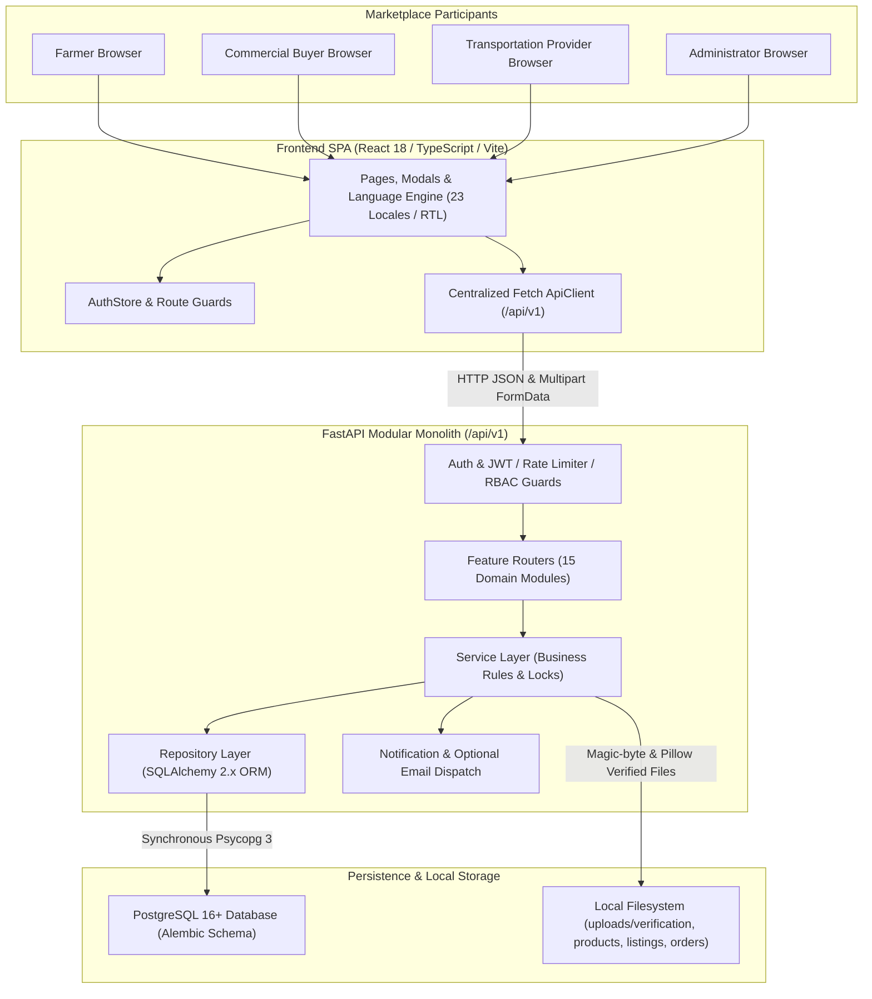
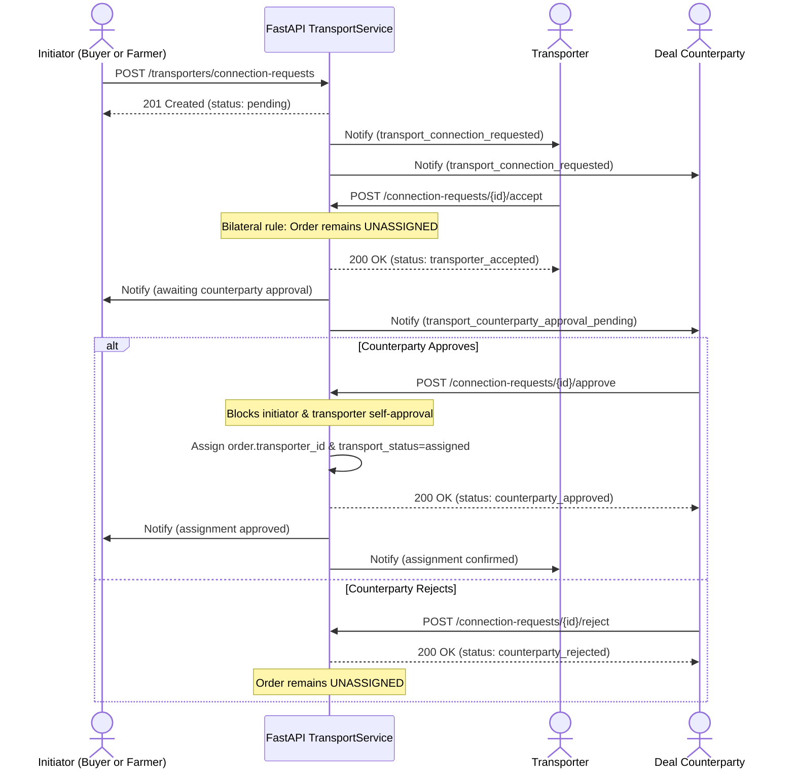

<div align="center">
  
</div>

# 🌾 AgriDirect
### Connecting Farmers, Commercial Buyers & Transportation Providers

<div align="center">

[](./backend/Dockerfile)
[](./backend/requirements.txt)
[](./frontend/package.json)
[](./frontend/package.json)
[](./docker-compose.yml)
[](./backend/requirements.txt)
[](./frontend/package.json)

</div>

**AgriDirect connects agricultural producers, commercial buyers, and independent transportation providers through a unified digital marketplace.** Built as a modular full-stack web application, it supports produce listing discovery, direct and negotiated ordering, inventory auditing, contextual communication, verification workflows, off-platform payment record tracking, descriptive market analytics, and bilateral transportation assignment approval across 23 languages.

> **Platform Boundary:** AgriDirect operates strictly as a trade and logistics coordination **facilitator**. It does **not** own agricultural produce or inventory, hold or process payments, or own or operate transportation fleets.

---

## Table of Contents

- [About the Project](#about-the-project)
- [Problem Statement](#problem-statement)
- [Proposed Solution](#proposed-solution)
- [Main Participants and Their Roles](#main-participants-and-their-roles)
- [Major Features and Modules](#major-features-and-modules)
- [Technology Stack](#technology-stack)
- [High-Level System Architecture](#high-level-system-architecture)
- [Backend Architecture](#backend-architecture)
- [Frontend Architecture](#frontend-architecture)
- [Database Design](#database-design)
- [End-to-End Application Workflows](#end-to-end-application-workflows)
- [Prerequisites](#prerequisites)
- [Installation Guide](#installation-guide)
- [Environment Variables](#environment-variables)
- [API Documentation](#api-documentation)
- [Testing](#testing)
- [Security and Data Integrity](#security-and-data-integrity)
- [File Storage](#file-storage)
- [Project Directory Structure](#project-directory-structure)
- [Screenshots and Visual Showcase](#screenshots-and-visual-showcase)
- [Future Scope](#future-scope)
- [Project Limitations](#project-limitations)
- [Academic Project Information](#academic-project-information)
- [License and Acknowledgements](#license-and-acknowledgements)

---

## About the Project

Agricultural trade frequently depends on fragmented, informal channels where farmers, commercial buyers (such as restaurants, hotels, retailers, wholesalers, food processors, and caterers), and freight haulers operate without shared visibility or structured workflows.

**AgriDirect** is designed to address this coordination gap by bringing all three independent participants onto a single web platform:

1. **Farmers** publish verified produce listings with pricing, quality grades, locations, available inventory, and product photographs, and respond to open buyer procurement requirements.
2. **Commercial Buyers** search listings, post structured procurement requirements, place direct purchase orders or negotiate structured offers, and review fulfillment progress.
3. **Transportation Providers** register independently with vehicle specifications and geographic service areas, review incoming haulage requests, and coordinate confirmed shipments.

To ensure fair governance across deals, AgriDirect enforces a **bilateral transportation assignment workflow**: neither a farmer nor a buyer can unilaterally assign a transporter to a shared transaction, and a transporter accepting a request does not finalize the assignment until the deal counterparty explicitly approves it.

---

## Problem Statement

Agricultural B2B trade and dispatch coordination commonly face several structural challenges that AgriDirect is designed to address:

- **Fragmented Trade Workflows:** Negotiation, order confirmation, order amendments, delivery acknowledgements, and payment record-keeping often occur across disconnected phone calls or messaging apps with no unified audit trail.
- **Difficulty Connecting Farmers and Commercial Buyers:** Producers lack direct discovery channels to reach verified institutional and commercial buyers, while buyers struggle to filter reliable commodity supply by grade, quantity, location, and unit.
- **Limited Real-Time Visibility of Produce Availability:** Without transactional inventory reservations and explicit amendment/cancellation accounting, stock availability easily falls out of sync with committed orders.
- **Independent Transportation Coordination Friction:** Even after a trade is agreed upon, locating available transporters covering both pickup and delivery districts—and securing mutual agreement from both trading parties on the selected carrier—is error-prone when handled informally.
- **Lack of Unified Order and Transport Lifecycle Management:** Linking specific orders or negotiated offers to transport connection requests, status updates, and bilateral completion acknowledgements is difficult without an integrated transaction model.
- **Language Accessibility Barriers:** Agricultural producers, buyers, and regional logistics operators across India work across diverse regional languages and scripts, creating adoption barriers in English-only interfaces.

---

## Proposed Solution

AgriDirect provides a role-aware, API-driven B2B marketplace organized around verified accounts and auditable state transitions:

- **Unified Three-Party Marketplace:** Distinct registration, profile, and dashboard experiences tailored to Farmers, Commercial Buyers, and Transportation Providers, supported by administrative verification and moderation tooling.
- **Structured Supply & Demand Discovery:** Publicly browsable produce catalog (`/marketplace`) and buyer requirements board, complemented by dedicated transporter discovery (`/transporters`) filtered by origin/destination state and district, vehicle type, and payload capacity.
- **Direct Ordering & Structured Negotiation:** Buyers can either purchase directly from active listings with atomic inventory deduction and idempotency protection, or negotiate price, quantity, and delivery terms through contextual chat and structured offer/counter-offer proposals.
- **Bilateral Transport Assignment Approval:** Transport requests connect a deal participant with a verified transporter; only after the transporter accepts **and** the counterparty approves does the backend assign the transporter to the order.
- **Verification-Gated Trade Facilitation:** All state-changing marketplace actions (listing produce, posting requirements, placing orders, sending offers, requesting transport, and initiating chats) are restricted on the backend to active, verified users.

---

## Main Participants and Their Roles

AgriDirect serves three primary marketplace participants, alongside an administrative oversight role responsible for document verification and governance.

| Capability | Farmer | Commercial Buyer | Transportation Provider | Administrator |
|---|:---:|:---:|:---:|:---:|
| **Account Registration & Login** | Role-specific onboarding | Role-specific onboarding | Role-specific fleet onboarding | Seeded / privileged role |
| **Document Verification Submission** | Farm & identity evidence | Business & tax/license evidence | RC & commercial permits | Reviews & approves/rejects |
| **Produce Listings & Product Images** | Create, edit, manage stock & photos | Browse & search catalog | Not permitted | Moderates content |
| **Buyer Requirements** | View & fulfill via offers | Post, update & review fulfillments | Not permitted | Moderates content |
| **Direct Ordering** | Confirm, amend, or cancel orders | Place direct orders (`POST /orders`) | Not permitted | Read/audit access |
| **Offer Negotiation & Chat** | Send/counter/accept/reject offers | Send/counter/accept/reject offers | Contextual messaging participant | Audit/moderation access |
| **Transportation Discovery & Requests** | Discover transporters & request haulage | Discover transporters & request haulage | Receives incoming requests | Governance oversight |
| **Bilateral Assignment Decision** | Approves/rejects buyer-initiated request | Approves/rejects farmer-initiated request | Accepts or declines incoming request | Cannot bypass counterparty consent |
| **Payment Tracking (Off-Platform)** | Acknowledges recorded payments | Records external payment & proof | Not applicable | Moderates payment complaints |
| **Dashboards & Descriptive Analytics** | Personal performance & market summary | Personal performance & market summary | Fleet availability, areas & requests | Platform-wide analytics & audit logs |

### Participant Functional Breakdown

- **Farmer:** Registers with farm details (`farm_name`, location, `farm_size_acres`, `farming_practices`, `primary_crops`), completes verification, publishes produce listings with up to 10 images, tracks inventory adjustment history, confirms or amends orders, responds to buyer requirements/offers, discovers transporters, initiates or approves/rejects transportation assignments, acknowledges external payment records, and monitors descriptive performance metrics.
- **Commercial Buyer:** Registers with business details (`business_name`, `business_type`, `business_registration_number`, `delivery_receiving_address`), completes verification, searches marketplace listings with faceted filters, posts procurement requirements and approves/rejects fulfillments, places direct purchase orders or negotiates offers in chat, attaches order reference images, discovers transporters, initiates or approves/rejects transportation assignments, records external payments with proof files, and tracks orders on the buyer dashboard.
- **Transportation Provider:** Registers independently with fleet details (`business_name`, `transport_type`, `vehicle_capacity_kg`, `vehicle_registration_number`, `experience_years`, `operating_states`, initial service areas), manages geographic coverage (`service_areas` by state, district, taluka/subdistrict, village/town, pincode, and `pickup_only`/`delivery_only`/`both`), toggles availability, submits compliance documents, reviews incoming transport connection requests, accepts or declines requests, and views awaiting-counterparty-approval vs. confirmed assignments on the Transporter Dashboard.

---

## Major Features and Modules

### 7.1 Authentication and Authorization
- **Credentials & Hashing:** Registration endpoints create `User` records with server-assigned roles (`farmer`, `buyer`, `transporter`), `verification_status='unverified'`, and Argon2id password hashes via `pwdlib[argon2]` ([`backend/app/core/security.py`](./backend/app/core/security.py)). Registration does not auto-login; users authenticate explicitly via `POST /api/v1/auth/login`.
- **Stateless Bearer JWT:** Access tokens are signed with `PyJWT[crypto]` (`HS256`/`HS384`/`HS512`) and carry expiration claims (`ACCESS_TOKEN_EXPIRE_MINUTES`, default 60 minutes).
- **Rate Limiting:** Login requests pass through an in-memory sliding-window rate limiter (`check_login_rate_limit` in [`backend/app/core/rate_limit.py`](./backend/app/core/rate_limit.py)) returning HTTP `429 Too Many Requests` with `Retry-After` headers.
- **Backend Dependency Guards:** FastAPI dependencies in [`backend/app/dependencies.py`](./backend/app/dependencies.py) (`get_current_active_user`, `require_verified_user`, `require_verified_farmer`, `require_verified_buyer`, `require_verified_transporter`, `require_admin`) enforce role and verification status on every protected endpoint.

### 7.2 Farmer Marketplace
- Verified farmers manage produce listings (`ProduceListing`) through status transitions (`draft`, `active`, `partially_fulfilled`, `closed`, `expired`) and soft-deletion (`is_deleted`, `deleted_at`).
- Free-form `product_name` support with optional hierarchical `ProduceCategory` taxonomy (`produce_categories`).
- Every stock deduction or release is tracked in an append-only `InventoryAdjustment` ledger (`inventory_adjustments`) viewable per order or listing.

### 7.3 Buyer Marketplace
- Public catalog browsing (`GET /api/v1/listings`) with keyword search, category, state/city, unit, price range, quality grade filtering, and sorting.
- Verified buyers publish `BuyerRequirement` records with target price conditions, quantity thresholds, and delivery deadlines, and review farmer fulfillments (`RequirementFulfillmentApproval`).
- Multi-item structured `Offer` negotiation (`pending`, `countered`, `accepted`, `rejected`, `withdrawn`, `expired`) linked to persistent buyer–farmer `Conversation` threads, contextual messaging with attachments, and mutual contact-sharing consent (`ContactShareRequest`).

### 7.4 Direct Order Management
- Verified buyers can place orders directly from active produce listings (`POST /api/v1/orders`) via [`OrderCreateModal.tsx`](./frontend/src/components/orders/OrderCreateModal.tsx) without requiring a prior negotiated offer (`source_offer_id = None`).
- **Concurrency & Idempotency:** `create_direct_order` in [`backend/app/orders/service.py`](./backend/app/orders/service.py) supports `X-Idempotency-Key` / payload `idempotency_key` (with a unique database index on `orders.idempotency_key` and `IntegrityError` collision recovery), acquires a row lock on the target listing (`lock_listing`), validates stock, deducts `available_quantity` atomically, creates `Order` and `OrderItem` snapshots, records an `InventoryAdjustment`, and notifies the farmer in one transaction.
- **Order Lifecycle & Amendments:** Supports farmer order confirmation (`/confirm`), atomic cancellation with inventory restitution (`/cancel`), bilateral post-finalization amendments (`/amendments/.../accept|reject`), delivery arrangement (`/delivery/arrange`), and dual-party delivery completion acknowledgement (`/delivery/mark-completed`, `/delivery/acknowledge`).

### 7.5 Product and Order Image Management
- **Local Filesystem Storage:** Both produce listing images (`ListingImage`) and order photographic assets (`OrderImage`) are stored locally on disk (no cloud object storage) with metadata, MIME types, and file sizes tracked in PostgreSQL.
- **Validation & Security:** [`backend/app/listings/storage.py`](./backend/app/listings/storage.py) and [`backend/app/orders/storage.py`](./backend/app/orders/storage.py) enforce extension allowlists (`.jpg`, `.jpeg`, `.png`, `.webp`), MIME allowlists, binary magic-byte header checks, Pillow image verification, decompression-bomb protection (`MAX_IMAGE_PIXELS = 25,000,000`), max 5 MB per image (`MAX_PRODUCT_IMAGE_SIZE_BYTES`), max 10 images per listing or order, server-generated UUID filenames, and canonical path traversal checks (`relative_to` / `is_relative_to`).
- **Access Control:** Active listing images are publicly streamable for marketplace display (`GET /api/v1/listings/{id}/images/{image_id}` and `/api/v1/products/{id}/images/{image_id}` alias), while draft/closed listing images and all order images (`GET /api/v1/orders/{id}/images/{image_id}`) require participant or admin authorization. Failed multi-file uploads clean up saved disk files on transaction rollback.

### 7.6 Transportation Marketplace
- Public/authenticated discovery (`GET /api/v1/transporters/discover`) matches active, verified transporters by `pickup_state`/`pickup_district` (`pickup_only` or `both`), `delivery_state`/`delivery_district` (`delivery_only` or `both`), `transport_type` (`mini_truck`, `open_body`, `refrigerated`, `covered_truck`, `tempo`, `trailer`, `other`), `min_capacity_kg`, and `is_available`.
- Farmers and buyers submit formal `TransportConnectionRequest` records linked to an order or offer (`cargo_description` up to 500 characters on the backend; summarized cleanly on the frontend with 255-character input limits) while duplicate active requests across `pending`, `transporter_accepted`, and `accepted` states are rejected with HTTP `409 Conflict`.

### 7.7 Bilateral Transportation Assignment Approval
AgriDirect enforces multi-party consent before committing a carrier to an order:

1. **Request Initiation:** Either the verified farmer or verified buyer on the deal submits a connection request (`status = 'pending'`).
2. **Transporter Response:** The target transporter accepts or declines on their dashboard.
3. **Awaiting Counterparty Consent:** Transporter acceptance transitions the request to `transporter_accepted` and records `transporter_accepted_at`—**transporter acceptance alone does not finalize the assignment or modify `order.transporter_id`.**
4. **Counterparty Notification:** The non-initiating deal participant (counterparty) receives an in-app notification (`transport_counterparty_approval_pending`) and sees approval controls in [`DealTransportSection.tsx`](./frontend/src/components/transport/DealTransportSection.tsx).
5. **Counterparty Decision:**
   - **Approve (`POST /api/v1/transporters/connection-requests/{request_id}/approve`):** Only the genuine deal counterparty (never the requester, transporter, or an uninvolved admin) can approve. Sets `status = 'counterparty_approved'`, records `counterparty_approved_by_id` and `counterparty_approved_at`, prevents overwriting if the order already has a different assigned transporter (`409 Conflict`), and atomically updates `order.transporter_id` and `order.transport_status = 'assigned'`.
   - **Reject (`POST /api/v1/transporters/connection-requests/{request_id}/reject`):** Sets `status = 'counterparty_rejected'`, stores optional `counterparty_rejection_reason`, and leaves the order unassigned.

*(Note: A pre-existing `POST /api/v1/orders/{order_id}/transport-coordination` endpoint also remains in [`backend/app/transporters/routes.py`](./backend/app/transporters/routes.py) for order-level transport status updates such as `in_transit`/`delivered` and coordination notes.)*

### 7.8 Notifications
- Persistent `Notification` records ([`backend/app/models/notification.py`](./backend/app/models/notification.py)) exposed via `GET /api/v1/notifications`, `GET /api/v1/notifications/unread-count`, and mark-read endpoints, surfaced in the UI via [`NotificationBell.tsx`](./frontend/src/components/notifications/NotificationBell.tsx).
- Dispatches domain events across verification decisions, offers/counter-offers, requirement fulfillment approvals, order creation/confirmation/cancellation/amendments/delivery, off-platform payments/disputes, user reports, reviews, moderation actions, and all bilateral transport lifecycle transitions (`transport_connection_requested`, `transport_connection_accepted`, `transport_counterparty_approval_pending`, `transport_assignment_approved`, `transport_assignment_confirmed`, `transport_assignment_rejected`, `transport_connection_declined`).
- Optional SMTP email dispatch is gated by `ENABLE_EMAIL_NOTIFICATIONS` (defaults to `false`).

### 7.9 Multilingual Support
- Configured in [`frontend/src/i18n/index.ts`](./frontend/src/i18n/index.ts) and [`frontend/src/i18n/languages.ts`](./frontend/src/i18n/languages.ts) using `i18next` and `react-i18next` across **23 languages** (English + all 22 languages in the Eighth Schedule of the Constitution of India) and **21 domain namespaces**.
- **Supported Languages:** `en` (English), `hi` (Hindi), `mr` (Marathi), `gu` (Gujarati), `bn` (Bengali), `ta` (Tamil), `te` (Telugu), `kn` (Kannada), `pa` (Punjabi), `ml` (Malayalam), `as` (Assamese), `or` (Odia), `sa` (Sanskrit), `ne` (Nepali), `kok` (Konkani), `mai` (Maithili), `doi` (Dogri), `brx` (Bodo), `mni` (Manipuri), `sat` (Santali), plus **RTL support** (`dir="rtl"`) for `ur` (Urdu), `ks` (Kashmiri), and `sd` (Sindhi) paired with logical Tailwind CSS directional utilities (`ms-*`, `me-*`, `text-start`, `text-end`, `rtl:rotate-180`).
- **Scope Note:** Automated tests validate language registry metadata, RTL layout mirroring, and translation key/placeholder parity across locales; formal linguistic review by native domain translators has not been conducted as part of the codebase checks.

### 7.10 Dashboards and Descriptive Analytics
- Dedicated dashboards for **Farmers** (`/dashboard/farmer`), **Buyers** (`/dashboard/buyer`), **Transporters** (`/dashboard/transporter`), and **Administrators** (`/admin/*`).
- Descriptive analytics module ([`backend/app/analytics/routes.py`](./backend/app/analytics/routes.py)) computes historical SQL aggregations using a read-only database dependency (`get_read_only_db`):
  - Public/filtered `market-summary` and `demand-summary` with privacy/statistical disclosure controls (`k >= 3` entity diversity and `>= 50%` dominance suppression).
  - Authenticated farmer/buyer `my-performance` metrics and administrator `platform` operational metrics.
  - All analytics are descriptive aggregations over historical data—no predictive AI or machine learning forecasting models are implemented.

---

## Technology Stack

Verified directly against [`backend/requirements.txt`](./backend/requirements.txt), [`frontend/package.json`](./frontend/package.json), [`backend/Dockerfile`](./backend/Dockerfile), [`frontend/Dockerfile`](./frontend/Dockerfile), and [`docker-compose.yml`](./docker-compose.yml):

| Layer | Technology | Purpose |
|---|---|---|
| **Frontend Framework** | React 18.3.1, TypeScript ~5.6.3 | Strict-mode SPA UI components, hooks, and type safety |
| **Routing & State** | React Router DOM 6.28.0, `useSyncExternalStore` (`AuthStore`) | Client-side role-guarded routes and lightweight auth state |
| **Localization** | `i18next` 27.1.3, `react-i18next` 18.0.2 | 23-language localization across 21 namespaces with LTR/RTL support |
| **Styling & Icons** | Tailwind CSS 3.4.16, PostCSS, `lucide-react`, `clsx`, `tailwind-merge` | Responsive design system and RTL-compatible utility styling |
| **Build Tooling** | Vite 5.4.11, ESLint 9.16, `typescript-eslint` | Fast HMR dev proxy, strict TypeScript bundling, and linting |
| **Backend Framework** | Python 3.12+ (tested on 3.13), FastAPI >= 0.115.0, Uvicorn | Modular monolith REST API under `/api/v1/` |
| **ORM & Driver** | SQLAlchemy >= 2.0 (synchronous `Session`), `psycopg[binary]` >= 3.1 | Synchronous relational persistence executed in FastAPI worker threadpool |
| **Validation & Settings** | Pydantic v2, `pydantic-settings` >= 2.0, `email-validator` | Strict request/response validation (`extra="forbid"`) and `.env` loading |
| **Authentication & Security** | `pwdlib[argon2]` >= 0.2, `PyJWT[crypto]` >= 2.8 | Argon2id password hashing and signed Bearer JWT verification |
| **Image Processing** | Pillow (`pillow` >= 10.0) | Format decoding and decompression-bomb safety verification |
| **Database & Migrations** | PostgreSQL 16+ (`postgres:16-alpine`), Alembic >= 1.13 | ACID relational data storage and versioned schema migrations |
| **Testing** | `pytest` >= 8.0, `httpx` >= 0.27, Vitest 2.1.8, React Testing Library, `jsdom` | Isolated backend unit/integration tests and frontend component/i18n tests |
| **Containerization** | Docker, Docker Compose, Nginx (`nginx:alpine`) | Multi-container local orchestration (`db`, `backend`, `frontend`) |

---

## High-Level System Architecture

AgriDirect is structured as a containerized three-service deployment with a **modular monolith** FastAPI backend and a React TypeScript SPA frontend.



---

## Backend Architecture

The backend (`backend/app/`) follows a strict modular monolith design separating domain responsibilities into dedicated packages (`auth`, `users`, `verification`, `listings`, `requirements`, `offers`, `orders`, `transporters`, `payments`, `chat`, `notifications`, `reviews`, `reports`, `admin`, `analytics`), each adhering to a consistent five-tier pattern:

```text
HTTP Request ──▶ Router (routes.py) ──▶ Schema (schemas.py) ──▶ Service (service.py) ──▶ Repository (repository.py) ──▶ Model (models/*.py)
```

| Layer | File Pattern | Responsibility |
|---|---|---|
| **Router** | `app/<module>/routes.py` | FastAPI endpoint declaration, query/path parameter parsing, `Depends(...)` authentication/RBAC guards, HTTP status mapping. Contains no business logic. |
| **Schema** | `app/<module>/schemas.py` | Pydantic v2 validation models (`ConfigDict(extra="forbid")`), field validators, numeric precision boundaries, and response serialization. |
| **Service** | `app/<module>/service.py` | Core business rules, ownership/counterparty authorization checks, row-locking orchestration, idempotency handling, and notification triggers. |
| **Repository** | `app/<module>/repository.py` | Parameterized SQLAlchemy 2.x ORM queries, joins, pagination, and `with_for_update()` locking helpers. |
| **Model** | `app/models/<domain>.py` | Declarative SQLAlchemy 2.x tables using UUID primary keys (`UUIDPrimaryKeyMixin`), UTC timestamps (`TimestampMixin`), foreign keys, indexes, and database `CHECK` constraints. |

**Concurrency Model (ADR-002):** As configured in [`backend/app/db/session.py`](./backend/app/db/session.py), database access uses synchronous SQLAlchemy `Session` and `psycopg` 3 inside standard `def` route handlers, which FastAPI executes on its worker threadpool without blocking the ASGI event loop.

---

## Frontend Architecture

The frontend (`frontend/src/`) is a strict-mode TypeScript React 18 SPA organized for lazy-loaded modularity and centralized HTTP error handling:

- **Routing & Guards ([`frontend/src/App.tsx`](./frontend/src/App.tsx)):** Routes use `React.lazy` code splitting across public pages (`/`, `/marketplace`, `/transporters`, `/login`, `/register/*`), role-guarded dashboards (`/dashboard/farmer`, `/dashboard/buyer`, `/dashboard/transporter`, `/dashboard/listings`, `/dashboard/requirements`, `/dashboard/offers`, `/dashboard/orders`, `/dashboard/messages`, `/dashboard/analytics`, `/dashboard/reports`, `/dashboard/profile`, `/dashboard/verification`), and the administrator console (`/admin/*`). Guards (`GuestOnly`, `RequireAuth`, `RequireRole`, `RequireAdmin`) validate state and guard against open redirects ([`frontend/src/utils/redirect.ts`](./frontend/src/utils/redirect.ts)).
- **Centralized API Client ([`frontend/src/api/client.ts`](./frontend/src/api/client.ts)):** Native `fetch` wrapper defaulting to `/api/v1` (proxied to `http://127.0.0.1:8000` by Vite in development), attaching `Authorization: Bearer <token>`, handling `FormData` uploads, streaming secure binary downloads (`downloadBlob`), mapping Pydantic 422 errors into `ApiError`, and emitting global 401/403 DOM events.
- **State Management ([`frontend/src/store/authStore.ts`](./frontend/src/store/authStore.ts)):** Framework-agnostic `AuthStore` wired to React via `useSyncExternalStore`, supporting login, role-specific registration, deduplicated `restoreSession()`, and logout.
- **Internationalization (`src/i18n/`):** Synchronizes `<html lang>` and `dir="ltr" | "rtl"` dynamically across 23 languages via `LanguageSelector` and persists user selection in `localStorage`.

---

## Database Design

AgriDirect uses PostgreSQL 16+ with UUID primary keys, UTC timestamp mixins, `NUMERIC` types for monetary/weight precision, and database-level `CHECK` and `UNIQUE` constraints.

### Entity Overview

| Domain | Tables | Key Relationships & Integrity Constraints |
|---|---|---|
| **Identity & Verification** | `users`, `farmer_profiles`, `buyer_profiles`, `transporter_profiles`, `service_areas`, `verification_submissions`, `verification_documents` | 1:1 role profiles linked to `users.id`; `service_areas` linked to `transporter_profiles.id`; multi-cycle verification history with evidence documents. |
| **Catalog & Demand** | `produce_categories`, `produce_listings`, `listing_images`, `buyer_requirements`, `requirement_fulfillment_approvals` | Self-referencing categories; `produce_listings` owned by farmer `users.id` (`available_quantity >= 0`); immutable approval records tracking fulfillment volume. |
| **Negotiation & Chat** | `conversations`, `conversation_participants`, `messages`, `message_attachments`, `contact_share_requests`, `offers`, `offer_items` | Reusable threads per farmer–buyer pair; self-referencing counter-offer lineage (`parent_offer_id`). |
| **Orders & Audit** | `orders`, `order_items`, `order_amendments`, `inventory_adjustments`, `order_delivery_acknowledgements`, `order_images` | Unique `source_offer_id` (nullable for direct orders) and unique `idempotency_key`; append-only `inventory_adjustments`; bilateral amendment & delivery records. |
| **Transportation** | `transport_connection_requests` | Links `requester_id`, `transporter_id`, optional `order_id`/`offer_id`, plus `counterparty_approved_by_id` / `counterparty_rejected_by_id` audit fields. `orders.transporter_id` assigned only upon bilateral approval. |
| **Payments, Trust & Admin** | `payment_records`, `payment_complaints`, `ratings_reviews`, `notifications`, `user_reports`, `admin_audit_logs` | External payment records (`UNIQUE` order review per reviewer); immutable admin governance audit logs. |

### Core Entity-Relationship Diagram

```mermaid
erDiagram
    USERS ||--o| FARMER_PROFILES : "has farmer profile"
    USERS ||--o| BUYER_PROFILES : "has buyer profile"
    USERS ||--o| TRANSPORTER_PROFILES : "has transporter profile"
    TRANSPORTER_PROFILES ||--o{ SERVICE_AREAS : "declares coverage"
    USERS ||--o{ VERIFICATION_SUBMISSIONS : "submits"
    VERIFICATION_SUBMISSIONS ||--o{ VERIFICATION_DOCUMENTS : "contains"

    USERS ||--o{ PRODUCE_LISTINGS : "publishes (farmer)"
    PRODUCE_CATEGORIES ||--o{ PRODUCE_LISTINGS : "categorizes"
    PRODUCE_LISTINGS ||--o{ LISTING_IMAGES : "has photos"
    USERS ||--o{ BUYER_REQUIREMENTS : "posts (buyer)"

    CONVERSATIONS ||--o{ MESSAGES : "contains"
    CONVERSATIONS ||--o{ OFFERS : "hosts negotiation"
    OFFERS ||--o{ OFFER_ITEMS : "details items"
    OFFERS ||--o| ORDERS : "instantiates on accept"

    USERS ||--o{ ORDERS : "buys / sells / transports"
    ORDERS ||--|{ ORDER_ITEMS : "snapshots items"
    ORDERS ||--o{ ORDER_AMENDMENTS : "tracks changes"
    ORDERS ||--o{ INVENTORY_ADJUSTMENTS : "audits stock"
    ORDERS ||--o{ ORDER_IMAGES : "attaches photos"
    ORDERS ||--o{ ORDER_DELIVERY_ACKNOWLEDGEMENTS : "confirms receipt"
    ORDERS ||--o{ TRANSPORT_CONNECTION_REQUESTS : "coordinates haulage"
    ORDERS ||--o{ PAYMENT_RECORDS : "records external payment"
    ORDERS ||--o{ RATINGS_REVIEWS : "receives mutual review"
```



---

## End-to-End Application Workflows

### Workflow A — Farmer Lists a Product
1. User registers via `/register/farmer` (`POST /api/v1/auth/register/farmer`), then logs in (`POST /api/v1/auth/login`).
2. Farmer uploads role-specific verification documents (Land Records, KCC, Photo ID, Organic/GAP certificates) on `/dashboard/verification` (`POST /api/v1/users/me/verification/documents`).
3. An Administrator reviews and approves the verification submission (`POST /api/v1/admin/verifications/{id}/approve`), setting `verification_status = 'verified'`.
4. Verified farmer navigates to `/dashboard/listings` and creates a produce listing (`POST /api/v1/listings`) specifying crop name, category, quantity, unit (`kg`, `quintal`, `metric_ton`, `bag`), unit price, quality grade, harvest/availability dates, and location.
5. Farmer uploads up to 10 photographs (`POST /api/v1/listings/{id}/images`), marks the primary thumbnail (`PATCH .../primary`), and publishes the listing as `active`.
6. The active listing appears immediately in the public `/marketplace` catalog for discovery.

### Workflow B — Buyer Places a Direct Order
1. Verified buyer browses `/marketplace`, filters produce, and opens a listing's `ProduceDetailModal`.
2. Buyer clicks to place a direct order, opening `OrderCreateModal` (which generates a per-modal UUID `idempotency_key` via `crypto.randomUUID()`).
3. Buyer enters desired volume, target delivery date, destination address, delivery notes, and optional reference images (up to 5 selected in the modal), then submits (`POST /api/v1/orders`).
4. Backend `OrderService.create_direct_order` verifies buyer role and verification status, checks idempotency, acquires a row lock (`lock_listing`) on the `ProduceListing`, verifies stock sufficiency, deducts `available_quantity` (closing the listing if stock reaches `0`), writes `Order`, `OrderItem`, `InventoryAdjustment`, and farmer `Notification` in a single atomic transaction (with `IntegrityError` collision recovery if an identical idempotency key commits concurrently).
5. If reference images were selected, the frontend uploads them to `POST /api/v1/orders/{id}/images`.
6. Both buyer and farmer view the order on `/dashboard/orders`, where the farmer confirms (`POST /api/v1/orders/{id}/confirm`), arranges delivery, and completes bilateral acknowledgement.

### Workflow C — Transportation Discovery and Bilateral Assignment Approval
1. On an active order (`OrderDetailModal`) or negotiated offer (`OfferDetailModal`), `DealTransportSection` loads connection requests and matching verified transporters based on pickup/delivery state, district, and cargo weight, or links to `/dashboard/transporters`.
2. Either the verified **farmer** or **buyer** (Initiator) opens `TransportConnectionModal`, verifies cargo summary (≤ 255 chars input / ≤ 500 chars backend schema), and submits `POST /api/v1/transporters/connection-requests` (duplicate active requests for the same provider and deal return HTTP `409 Conflict`).
3. The selected **Transporter** views the `pending` request on `/dashboard/transporter` and clicks **Accept** (`POST /api/v1/transporters/connection-requests/{id}/accept`) or **Decline** (`.../decline`).
4. Upon transporter acceptance, status transitions to `transporter_accepted`. **The order remains unassigned** (`order.transporter_id` is still `null`). Both parties receive notifications, and the deal **Counterparty** receives an approval-pending notification.
5. The **Counterparty** reviews the accepted request in `DealTransportSection` (`can_current_user_approve = true`):
   - **Approve (`POST .../approve`):** Transitions to `counterparty_approved`, verifies the order is not already assigned to another carrier, atomically sets `order.transporter_id` and `order.transport_status = 'assigned'`, and notifies all three parties.
   - **Reject (`POST .../reject`):** Transitions to `counterparty_rejected`, saves the rejection reason, and leaves the order unassigned so another transporter can be requested.



### Workflow D — Transportation Provider Registration & Service Areas
1. Provider navigates to `/register/transporter` and submits `TransporterRegisterRequest` (`email`, `password` ≥ 8 chars, `phone_number`, `business_name`, `contact_name`, `transport_type`, `vehicle_capacity_kg > 0`, `vehicle_registration_number`, `experience_years`, optional `operating_states`/`bio`, and initial `ServiceArea` entries).
2. Backend hashes password via Argon2id, assigns `role = 'transporter'`, `verification_status = 'unverified'`, and creates `User`, `TransporterProfile`, and `ServiceArea` rows (`POST /api/v1/auth/register/transporter`).
3. Provider logs in (`/login`) and accesses `/dashboard/transporter`.
4. Provider submits verification evidence (e.g., Vehicle RC / commercial permit) on `/dashboard/verification` for admin approval. Only `verified` and `active` transporters appear in `/transporters/discover` or can receive connection requests.
5. Provider manages availability (`PATCH /api/v1/transporters/me`) and CRUD service areas (`POST/PATCH/DELETE /api/v1/transporters/service-areas`), where backend checks prevent duplicate `(state, district, coverage_type)` entries.

---

## Prerequisites

Verified from [`backend/Dockerfile`](./backend/Dockerfile), [`backend/README.md`](./backend/README.md), [`frontend/Dockerfile`](./frontend/Dockerfile), and [`docker-compose.yml`](./docker-compose.yml):

| Requirement | Version / Notes |
|---|---|
| **Python** | `3.12+` (Docker image uses `python:3.12-slim`; local workspace uses `3.13.14`) |
| **Node.js** | `20+` (Docker image uses `node:20-alpine`; local workspace uses `v24.22.0`) |
| **npm** | `10+` (local workspace uses `11.19.1`) |
| **PostgreSQL** | `16+` (`postgres:16-alpine` in `docker-compose.yml`) |
| **Git** | Any current version |
| **Docker & Docker Compose** | Optional — required only for containerized setup via `docker-compose.yml` |

---

## Installation Guide

### Step 1 — Clone the Repository

```bash
git clone https://github.com/adityamaheshwari932-oss/AgriDirect.git
cd AgriDirect
```

### Step 2 — Database Setup (PostgreSQL 16+)

Create a dedicated PostgreSQL role and database (replace `<YOUR_PASSWORD>` with a secure local password):

```sql
CREATE USER agridirect_app WITH PASSWORD '<YOUR_PASSWORD>';
CREATE DATABASE agridirect_db OWNER agridirect_app;
```

### Step 3 — Backend Setup

1. Create and activate a virtual environment inside `backend/`:

   **Windows (PowerShell):**
   ```powershell
   cd backend
   python -m venv .venv
   .\.venv\Scripts\Activate.ps1
   ```

   **Linux / macOS:**
   ```bash
   cd backend
   python3 -m venv .venv
   source .venv/bin/activate
   ```

2. Install Python dependencies:

   ```bash
   python -m pip install -r requirements.txt
   ```

3. Configure environment variables:

   ```powershell
   # Windows PowerShell
   Copy-Item .env.example .env
   ```
   ```bash
   # Linux / macOS
   cp .env.example .env
   ```
   Edit `backend/.env` to set your real `DATABASE_URL` password and generate a 64-hex-character `SECRET_KEY`:
   ```bash
   python -c "import secrets; print(secrets.token_hex(32))"
   ```

4. Inspect and run Alembic migrations (see the [Project Limitations](#project-limitations) note regarding multiple migration heads before running `upgrade`):

   ```bash
   alembic heads
   alembic upgrade heads
   ```

5. Start the FastAPI backend server:

   ```bash
   python -m uvicorn app.main:app --reload --host 127.0.0.1 --port 8000
   ```

### Step 4 — Frontend Setup

Open a second terminal from the repository root:

```bash
cd frontend
npm install
```

Create a local environment file from [`frontend/.env.example`](./frontend/.env.example):

```powershell
# Windows PowerShell
Copy-Item .env.example .env
```
```bash
# Linux / macOS
cp .env.example .env
```

Start the Vite development server:

```bash
npm run dev
```

Or create an optimized production bundle:

```bash
npm run build
```

### Step 5 — Run the Application

#### Option A: Local Development Servers
- **Frontend UI:** `http://localhost:5174` (configured with `strictPort: true` in [`frontend/vite.config.ts`](./frontend/vite.config.ts); proxies `/api/v1` requests to `http://127.0.0.1:8000`)
- **Backend API:** `http://127.0.0.1:8000`
- **API Health Check:** `http://127.0.0.1:8000/health`

#### Option B: Docker Compose (Containerized)
From the repository root:

```bash
cp .env.example .env   # or Copy-Item .env.example .env in PowerShell
# Edit .env to replace default credentials and SECRET_KEY
docker compose up --build -d
```

Docker Compose exposes:
- **Frontend (Nginx):** `http://localhost:5173` (`${FRONTEND_PORT:-5173}`)
- **Backend (Uvicorn):** `http://localhost:8000` (`${BACKEND_PORT:-8000}`)
- **PostgreSQL:** `localhost:5432` (`${POSTGRES_PORT:-5432}`)

*(Note: Verify Alembic migrations are applied against the container database if initializing a fresh PostgreSQL volume.)*

---

## Environment Variables

All environment variables below are verified directly from [`backend/app/core/config.py`](./backend/app/core/config.py), [`backend/.env.example`](./backend/.env.example), [`frontend/.env.example`](./frontend/.env.example), and root [`.env.example`](./.env.example).

| Variable | Component | Purpose | Safe Example |
|---|---|---|---|
| `APP_ENV` | Backend | Runtime mode (`development` \| `testing` \| `production`) | `development` |
| `DATABASE_URL` | Backend | Required synchronous SQLAlchemy Psycopg 3 PostgreSQL URL | `postgresql+psycopg://agridirect_app:<PASSWORD>@localhost:5432/agridirect_db` |
| `SECRET_KEY` | Backend | Required JWT signing secret (≥ 32 chars, not `REPLACE_ME`) | `<64_CHAR_HEX_SECRET>` |
| `JWT_ALGORITHM` | Backend | JWT signing algorithm (`HS256` \| `HS384` \| `HS512`) | `HS256` |
| `ACCESS_TOKEN_EXPIRE_MINUTES` | Backend | JWT access token lifetime in minutes | `60` |
| `ENABLE_AUTH_RATE_LIMIT` | Backend | Enables/disables login sliding-window rate limiter | `true` |
| `AUTH_RATE_LIMIT_MAX_ATTEMPTS` | Backend | Max login attempts per IP per window | `5` |
| `AUTH_RATE_LIMIT_WINDOW_SECONDS` | Backend | Login rate-limit window duration in seconds | `60` |
| `UPLOAD_DIR` | Backend | Verification documents root directory (chat/payments derive subdirs) | `uploads/verification` |
| `MAX_UPLOAD_SIZE_BYTES` | Backend | Max verification/attachment upload size in bytes | `10485760` |
| `LISTING_IMAGES_DIR` | Backend | Legacy/fallback produce listing image directory | `uploads/listings` |
| `PRODUCT_IMAGES_DIR` | Backend | Primary directory for product photographs | `uploads/products` |
| `MAX_PRODUCT_IMAGES_PER_LISTING` | Backend | Max images allowed per listing/product | `10` |
| `MAX_PRODUCT_IMAGE_SIZE_BYTES` | Backend | Max product/order image size in bytes | `5242880` |
| `DEFAULT_OFFER_EXPIRY_HOURS` | Backend | Default offer validity window in hours | `72` |
| `ENABLE_EMAIL_NOTIFICATIONS` | Backend | Feature flag for operational SMTP alerts | `false` |
| `SMTP_HOST` | Backend | Optional SMTP server hostname (when email enabled) | `smtp.example.com` |
| `SMTP_PORT` | Backend | Optional SMTP TCP port | `587` |
| `SMTP_USER` | Backend | Optional SMTP login username | `notifications@example.com` |
| `SMTP_PASSWORD` | Backend | Optional SMTP password/token | `<SMTP_PASSWORD>` |
| `SMTP_FROM_EMAIL` | Backend | Optional sender email address | `notifications@example.com` |
| `VITE_API_BASE_URL` | Frontend | API prefix or base URL used by `ApiClient` | `/api/v1` |
| `VITE_APP_TITLE` | Frontend | Frontend brand title | `AgriDirect` |
| `POSTGRES_DB` / `USER` / `PASSWORD` / `PORT` | Docker | PostgreSQL container database credentials & port | `agridirect_db` / `agridirect_app` / `<PASSWORD>` / `5432` |
| `BACKEND_PORT` / `FRONTEND_PORT` | Docker | Exposed host ports for `docker-compose.yml` | `8000` / `5173` |

---

## API Documentation

- **API Version Prefix:** `/api/v1`
- **Authentication:** `Authorization: Bearer <access_token>` obtained from `POST /api/v1/auth/login`
- **Interactive Docs (FastAPI):**
  - **Swagger UI:** `http://127.0.0.1:8000/docs`
  - **ReDoc:** `http://127.0.0.1:8000/redoc`
  - **OpenAPI Schema:** `http://127.0.0.1:8000/openapi.json`
  - **Health Check:** `http://127.0.0.1:8000/health`

### Representative Resource Groups

| Resource Group | Base / Representative Paths | Primary Responsibilities |
|---|---|---|
| **Authentication** | `/api/v1/auth/register/{farmer\|buyer\|transporter}`, `/api/v1/auth/login` | Role registration and rate-limited JWT login |
| **Users & Profiles** | `/api/v1/users/me`, `/api/v1/users/me/{farmer\|buyer}` | Authenticated profile reads and role-specific updates |
| **Verification** | `/api/v1/users/me/verification*`, `/api/v1/admin/verifications*` | Evidence document uploads, downloads, history, and admin approval/rejection |
| **Listings & Products** | `/api/v1/listings*`, `/api/v1/products/{id}/images*` | Catalog search, farmer listings, status transitions, and product media |
| **Requirements** | `/api/v1/requirements*`, `/api/v1/requirements/fulfillments/{id}/*` | Buyer procurement demand posts and farmer fulfillment approvals |
| **Offers & Chat** | `/api/v1/offers*`, `/api/v1/conversations*`, `/api/v1/attachments/{id}` | Structured proposals/counter-offers, messaging, attachments, contact-share consent |
| **Orders & Inventory** | `/api/v1/orders*`, `/api/v1/orders/{id}/images*`, `/api/v1/listings/{id}/inventory-adjustments` | Direct orders, amendments, delivery coordination/acknowledgements, inventory ledger, order photos |
| **Transporters** | `/api/v1/transporters/me`, `/api/v1/transporters/service-areas*`, `/api/v1/transporters/discover`, `/api/v1/transporters/connection-requests*` | Transporter onboarding/areas, discovery, and bilateral assignment approval/rejection |
| **Payments & Reviews** | `/api/v1/orders/{id}/payments*`, `/api/v1/payment-complaints*`, `/api/v1/reviews*` | Off-platform payment recording, proof/dispute evidence, and completed-order reviews |
| **Notifications** | `/api/v1/notifications*` | Scoped operational notifications, unread badge count, read state |
| **Analytics & Admin** | `/api/v1/analytics/*`, `/api/v1/reports*`, `/api/v1/admin/*` | Descriptive summaries, safety reports, user/content moderation, audit logs |

---

## Testing

### Test Infrastructure
- **Backend:** `pytest` + FastAPI `TestClient` / `httpx` configured via [`backend/pyproject.toml`](./backend/pyproject.toml). The repository contains 47 test files under [`backend/tests/`](./backend/tests/), including unit/API suites using an isolated in-memory SQLite database (requiring `DATABASE_URL=sqlite:///:memory:` and `SECRET_KEY`) as well as PostgreSQL concurrency/integration suites (`test_postgres_module3.py` – `test_postgres_module10.py`).
- **Frontend:** `Vitest` + `@testing-library/react` + `jsdom` configured in [`frontend/vite.config.ts`](./frontend/vite.config.ts) with 66 `*.test.*` files across API clients, pages, components, route guards, `authStore`, and 23-language/RTL checks.

### Reproducible Commands

**Backend Tests (Isolated In-Memory SQLite, PowerShell):**
```powershell
$env:DATABASE_URL="sqlite:///:memory:"
$env:SECRET_KEY="test-secret-key-32-chars-long-minimum!"
backend\.venv\Scripts\python.exe -m pytest backend/tests --ignore-glob="backend/tests/test_postgres_*.py" -v
```

**Backend Core Feature Suites (Auth, Listings, Images, Orders, Transporters):**
```powershell
$env:DATABASE_URL="sqlite:///:memory:"
$env:SECRET_KEY="test-secret-key-32-chars-long-minimum!"
backend\.venv\Scripts\python.exe -m pytest `
  backend/tests/test_auth_api.py `
  backend/tests/test_listings_api.py `
  backend/tests/test_product_images_api.py `
  backend/tests/test_orders_api.py `
  backend/tests/test_direct_orders_and_images.py `
  backend/tests/test_transporters_api.py `
  backend/tests/test_transporter_marketplace_and_connections.py -v
```

**Frontend Tests, Typecheck, Linter, and Build:**
```bash
cd frontend
npx tsc --noEmit
npm run lint
npm run test
# Note: On Windows environments experiencing worker pool hangs, run with --pool=forks:
# npx vitest run --pool=forks
npm run build
```

### Verification Scope and Status

| Verification Scope | Status | Details |
|---|---|---|
| **Backend Core Feature Suites (SQLite)** | **Passed** | `test_auth_api.py`, `test_listings_api.py`, `test_product_images_api.py`, `test_orders_api.py`, `test_direct_orders_and_images.py`, `test_transporters_api.py`, and `test_transporter_marketplace_and_connections.py` executed and passed. |
| **Backend Alembic Config Suite** | **Known Failure** | `backend/tests/test_alembic_config.py` currently fails 3 tests (`MultipleHeads` error due to duplicate revision ID `e5f6a1b2c3d4` in `backend/alembic/versions/`). |
| **Frontend Typecheck & Production Build** | **Passed** | `npx tsc --noEmit` (0 errors) and `npm run build` (`tsc -b && vite build`) succeeded. |
| **Frontend Core i18n, RTL, Order & Transporter Tests** | **Passed** | Executed and passed for `i18n.test.ts`, `indic-translations.test.tsx`, `rtl.test.tsx`, `OrderCreateModal.test.tsx`, `OrderDetailModal.test.tsx`, and `TransporterDashboardPage.test.tsx` (`--pool=forks`). |
| **Live PostgreSQL Suites & Alembic Upgrade** | **Not Verified** | `test_postgres_module*.py` and live PostgreSQL migration execution were not run during this documentation pass. |
| **Browser E2E & Coverage Percentage** | **Not Verified** | No Playwright/Cypress E2E suite or coverage percentage report is currently configured in the repository. |

---

## Security and Data Integrity

Verified security and integrity controls implemented in the source code:

- **Argon2id Password Hashing:** Plaintext passwords are never stored or logged; hashed with `Argon2Hasher` via `pwdlib`.
- **Server-Side RBAC & Verification Enforcement:** Route dependencies and service guards reject unauthenticated (`401`), unverified, or wrong-role (`403`) API requests regardless of frontend UI state.
- **Input & Schema Strictness:** Pydantic v2 schemas configured with `extra="forbid"` reject unexpected properties before reaching services or repositories.
- **SQL Injection Prevention:** All database operations use parameterized SQLAlchemy 2.x ORM queries; descriptive analytics use read-only database sessions with parameterized ORM/SQL filters.
- **Login Rate Limiting:** Sliding-window per-IP rate limiting protects `POST /api/v1/auth/login` against brute-force attempts without trusting unconfigured `X-Forwarded-For` headers.
- **File Upload Hardening:** Extension/MIME filtering, binary magic-byte validation, Pillow decoding with 25 MP pixel caps, UUID filenames, and canonical path traversal boundary assertions protect every upload module.
- **Transactional Consistency & Idempotency:** Direct order placement uses listing row locks (`lock_listing`), atomic inventory ledger entries, and unique `idempotency_key` collision recovery; accepted offers enforce `source_offer_id` uniqueness; order modifications post-confirmation require bilateral `OrderAmendment` confirmation.
- **Bilateral Transport & Contact Consent:** Transport assignment requires transporter acceptance plus explicit counterparty approval (blocking requester and transporter self-approval and preventing transporter overwrites via HTTP `409`); direct phone/email disclosure in chat requires bilateral `ContactShareRequest` consent.
- **Non-Custodial Boundary:** No payment gateway SDKs, bank transfers, escrow accounts, or carrier fleet dispatch engines exist in the codebase.

---

## File Storage

AgriDirect stores uploaded binary files on the **local filesystem** while saving metadata (`image_uri`, `mime_type`, `file_size_bytes`, uploader ID) in PostgreSQL:

| Asset Type | Default Storage Directory | Configurable Setting | Access Model |
|---|---|---|---|
| **Verification Documents** | `uploads/verification/` | `UPLOAD_DIR` | Owner & Admin only (authenticated download) |
| **Product / Listing Images** | `uploads/products/` (fallback `uploads/listings/`) | `PRODUCT_IMAGES_DIR` / `LISTING_IMAGES_DIR` | Public for `active` listings; owner/admin for draft/closed |
| **Order Photographs** | `uploads/orders/` (sibling of product/listing dir) | `PRODUCT_IMAGES_DIR` / `LISTING_IMAGES_DIR` parent | Order counterparties & Admin only (`GET /orders/{id}/images/{img_id}`) |
| **Chat Attachments** | `uploads/verification/chat/` (subdir of `UPLOAD_DIR`) | `UPLOAD_DIR` | Conversation participants & Admin |
| **Payment Proofs & Evidence** | `uploads/verification/payments/{proofs\|evidence}/` | `UPLOAD_DIR` | Order counterparties & Admin |

Because uploads are stored locally (mounted to the `backend_uploads` volume under `/app/uploads` in [`docker-compose.yml`](./docker-compose.yml)), **upload directories must be backed up or migrated separately** when moving or reinstalling the application.

---

## Project Directory Structure

```text
AgriDirect/
├── backend/
│   ├── alembic/                  # Database schema migration environment & 15 version scripts
│   ├── app/
│   │   ├── main.py               # FastAPI app factory, CORS config, /health, router registration
│   │   ├── dependencies.py       # JWT auth, active/verified user & role RBAC dependencies
│   │   ├── core/                 # Config (BaseSettings), Argon2 security, login rate limiter
│   │   ├── db/                   # Declarative Base & synchronous SQLAlchemy Session manager
│   │   ├── models/               # SQLAlchemy 2.x ORM entity definitions across all domains
│   │   ├── auth/                 # Farmer, buyer, transporter registration & JWT login
│   │   ├── users/                # Current user & role-specific profile endpoints
│   │   ├── verification/         # Document verification submission, uploads & admin review
│   │   ├── listings/             # Produce categories, catalog search, farmer listings & images
│   │   ├── requirements/         # Buyer procurement requirements & fulfillment approvals
│   │   ├── offers/               # Structured multi-item offers & counter-offer negotiation
│   │   ├── orders/               # Direct orders, amendments, delivery acks, inventory ledger & photos
│   │   ├── transporters/         # Transporter profiles, service areas, discovery & bilateral assignment
│   │   ├── chat/                 # Conversations, messages, attachments & contact-share requests
│   │   ├── payments/             # Off-platform payment recording, proofs & dispute complaints
│   │   ├── reviews/              # Completed-order counterparty ratings & reputation summaries
│   │   ├── reports/              # User safety reporting & moderation
│   │   ├── admin/                # Governance, moderation & immutable AdminAuditLog endpoints
│   │   ├── analytics/            # Descriptive market, demand, personal & platform SQL analytics
│   │   └── notifications/        # In-app notification persistence & optional SMTP hooks
│   ├── tests/                    # pytest unit, API integration, security & PG concurrency tests
│   ├── .env.example              # Backend environment template
│   ├── alembic.ini               # Alembic configuration
│   ├── Dockerfile                # Python 3.12-slim non-root container image
│   ├── pyproject.toml            # pytest configuration
│   └── requirements.txt          # Direct Python runtime & test dependencies
├── frontend/
│   ├── public/                   # Static assets including favicon.svg
│   ├── src/
│   │   ├── api/                  # Native Fetch ApiClient, error normalization & typed endpoint clients
│   │   ├── components/           # Feature modals/cards (marketplace, orders, offers, transport, chat, UI)
│   │   ├── hooks/                # Custom React hooks
│   │   ├── i18n/                 # 23-language resource bundles (21 namespaces each) & LTR/RTL engine
│   │   ├── pages/                # Route-level pages for Farmer, Buyer, Transporter, Marketplace & Admin
│   │   ├── store/                # AuthStore (useSyncExternalStore)
│   │   ├── test/                 # Vitest + Testing Library setup
│   │   ├── types/                # Domain TypeScript interfaces matching backend schemas
│   │   └── utils/                # Formatters, status mappers, class helpers & redirect guards
│   ├── .env.example              # Frontend environment template
│   ├── Dockerfile                # Multi-stage Node 20 builder + Nginx runtime image
│   ├── package.json              # Scripts & npm dependencies
│   └── vite.config.ts            # Vite proxy (/api/v1 -> 127.0.0.1:8000), build chunks & Vitest config
├── docs/                         # Project SRS, DFD docs, ADRs (ADR-002..014) & DB schema design
├── uploads/                      # Local development upload storage root (ignored by Git)
├── .env.example                  # Root Docker Compose environment template
├── AGENTS.md                     # Architectural rules & coding standards
├── IMPLEMENTATION_PLAN.md        # Phased development roadmap
├── PROJECT_CONTEXT.md            # Initial Phase 0 project scope & business rules baseline
└── docker-compose.yml            # Multi-service PostgreSQL + FastAPI + Nginx composition
```

---

## Screenshots and Visual Showcase

The repository currently includes the vector platform emblem [`frontend/public/favicon.svg`](./frontend/public/favicon.svg), and no static application screenshots are checked into version control yet. Before final project presentation or viva evaluation, screenshots captured from the running local application can be placed in `docs/screenshots/` and linked below:

| View | Planned Capture |
|---|---|
| **Landing & Marketplace** | Public catalog (`/` & `/marketplace`) with search filters and produce detail modal |
| **Farmer & Buyer Dashboards** | Verification status, profile completion tracker, active listings/requirements & orders |
| **Direct Order Modal** | `OrderCreateModal` with inventory calculation and order photo attachment |
| **Bilateral Transport Approval** | `DealTransportSection` counterparty approval card and `TransporterDashboardPage` status badges |
| **Multilingual & RTL UI** | `LanguageSelector` switching into an Indic language and Urdu/Kashmiri/Sindhi RTL layout |

---

## Future Scope

The following items represent potential future engineering enhancements and are **not currently implemented**:

- **Alembic History Consolidation:** Reconciling the duplicate revision identifier (`e5f6a1b2c3d4`) and merging the two Alembic migration heads into a single linear revision graph.
- **Object Storage Migration:** Moving local filesystem uploads (`uploads/`) to managed cloud object storage (such as S3-compatible storage) for stateless horizontal scaling.
- **Refresh Tokens with `HttpOnly` Cookies:** Implementing backend refresh token rotation stored in `HttpOnly`, `SameSite=Strict` cookies instead of `sessionStorage` access tokens.
- **Distributed Rate Limiting:** Replacing the process-local in-memory login rate limiter with a shared store (e.g., Redis) or reverse-proxy rate limiting for multi-worker deployments.
- **Direct Coordination Endpoint Alignment:** Deprecating or gating the legacy `transporter_user_id` assignment path on `POST /api/v1/orders/{id}/transport-coordination` so all assignment paths strictly traverse bilateral connection-request approval.
- **Linguistic QA & E2E Automation:** Native-speaker translation review across all 22 Scheduled Indian languages, automated browser end-to-end testing (Playwright/Cypress), code coverage thresholds in CI, and production deployment automation.

---

## Project Limitations

To maintain technical transparency during evaluation, note the following verified architectural and current repository limitations:

1. **Duplicate Alembic Revision ID / Multiple Heads:** `backend/alembic/versions/` currently contains two migration files sharing revision ID `e5f6a1b2c3d4` (`e5f6a1b2c3d4_create_order_delivery_acknowledgements.py` and `e5f6a1b2c3d4_add_bilateral_transport_assignment.py`) creating two Alembic heads (`d4e5f6a1b2c5` and `e5f6a1b2c3d4`). Fresh setups must inspect `alembic heads` rather than blindly running `alembic upgrade head`, and `test_alembic_config.py` currently fails 3 tests on this basis.
2. **Local Filesystem Storage:** Uploaded verification documents, product photos, order photos, chat attachments, and payment proofs reside on local disk (`uploads/`) or a local Docker volume (`backend_uploads`).
3. **No Payment Gateway or Escrow:** AgriDirect tracks buyer payment declarations, uploaded receipts, and disputes off-platform; it does not integrate Razorpay, Stripe, UPI APIs, or hold funds.
4. **No Fleet Management or GPS Tracking:** Transportation coordination handles discovery, availability declarations, connection requests, and bilateral assignment status only.
5. **Single-Instance Rate Limiting & Token Storage:** Login rate limiting is process-local in memory (`InMemoryRateLimiter`), and frontend JWT tokens are held in browser `sessionStorage` without refresh token rotation.
6. **Live PostgreSQL & Browser E2E Verification Pending:** While SQLite-backed backend tests, TypeScript checks, production bundling, and core Vitest suites were executed and verified, live PostgreSQL concurrency suites (`test_postgres_module*.py`), full PostgreSQL migration runs, and automated browser E2E suites remain unverified in this pass.

---

## Academic Project Information

> Replace the placeholder fields below with your official university/institution submission metadata prior to submitting.

| Field | Details |
|---|---|
| **Project Title** | AgriDirect — Direct B2B Agricultural Marketplace & Bilateral Transport Coordination Platform |
| **Project Type** | `<Final-Year Engineering Project / Capstone Project>` |
| **Degree / Program** | `<B.E. / B.Tech. / M.C.A. / Degree Name>` |
| **Department** | `<Department of Computer Science & Engineering>` |
| **Institution** | `<University / College Name>` |
| **Academic Year** | `<YYYY–YYYY>` |
| **Submitted By** | `<Student Name(s)>` |
| **Roll / Enrollment Number(s)** | `<Roll Number(s)>` |
| **Guided By** | `<Supervisor / Professor Name & Designation>` |

---

## License and Acknowledgements

- **License:** No `LICENSE` file is currently present in the repository root. Unless a license file is added by the project maintainers, rights remain with the repository authors.
- **Project Documentation & Design References:** Architecture decisions, database specifications, Data Flow Diagrams, and Software Requirements Specifications live in [`docs/`](./docs/) (including [`docs/database/schema-design.md`](./docs/database/schema-design.md), [`docs/architecture/`](./docs/architecture/), [`docs/dfd/`](./docs/dfd/), [`docs/srs/`](./docs/srs/), [`AGENTS.md`](./AGENTS.md), and [`IMPLEMENTATION_PLAN.md`](./IMPLEMENTATION_PLAN.md)).
- **Open-Source Ecosystem:** Built using FastAPI, SQLAlchemy, Pydantic, Alembic, Psycopg 3, `pwdlib` (Argon2), PyJWT, Pillow, PostgreSQL, React, TypeScript, Vite, Tailwind CSS, Lucide Icons, `i18next`, pytest, and Vitest.
