# AgriDirect — Relational Database Architecture & Schema Specification
**Document Version:** 1.1 — Implementation-Ready Baseline (Aligned with Finalized Owner Decisions)
**Target Engine:** PostgreSQL 16+ (via SQLAlchemy 2.x & Alembic)
**Document Purpose:** Educational engineering reference and authoritative implementation specification for AgriDirect backend developers.

---

## 1. Executive Summary & Context

AgriDirect is a centralized B2B agricultural marketplace connecting **Farmers** (sellers) directly with **Commercial Buyers** (restaurants, hotels, retailers, food processors, caterers, and wholesalers). The platform facilitates discovery, negotiation, and transaction coordination while purposefully avoiding intermediary ownership of physical goods, payment escrow holding, or logistics fleet management.

This document establishes the normalized relational database architecture required for Phase 2 onwards. It translates the project's **Software Requirements Specification (SRS v1.0)**, **Data Flow Diagrams (DFD Level 0–2)**, and the **12 Finalized Project-Owner Architectural Decisions** into an implementation-ready PostgreSQL schema.

---

## 2. Educational Foundation: Core Engineering Decisions

For students and backend engineers learning software design, database schemas must not simply be presented as finished tables. The architectural tradeoffs, normalization stages, and failure modes that guided each design choice must be understood.

### 2.1 Why PostgreSQL and a Relational Model?
A marketplace that coordinates legally binding trade agreements requires strict **ACID** (Atomicity, Consistency, Isolation, Durability) guarantees:
* **Atomicity:** When an offer is accepted, creating an order, snapshotting line items, updating offer status, and recording inventory deductions must succeed as a single atomic unit. If any step fails, the entire transaction rolls back.
* **Consistency:** Database-level `CHECK` constraints prevent negative inventory, negative prices, and invalid state transitions before application bugs can corrupt persistent data.
* **Referential Integrity:** Foreign keys guarantee that orphaned records (e.g., an order referencing a non-existent buyer or a message without a conversation) cannot be created.
* **Auditability:** Relational joins between immutable audit ledgers (`order_amendments`, `inventory_adjustments`) and entity snapshots allow historical recreation of past business states.

### 2.2 Surrogate UUID Primary Keys vs. Natural Keys
* **The Antipattern:** Using natural business keys (e.g., user email, phone number, or government registration number) as primary keys.
* **The Engineering Failure:** Natural keys frequently change (a user updates their phone number, a business changes its legal name). Cascading primary key updates across dozens of referencing foreign key tables locks rows and degrades system performance. Furthermore, sequential auto-incrementing integers (`id BIGSERIAL`) expose systems to **enumeration attacks** (competitors can scrape `GET /api/orders/1`, `GET /api/orders/2` to infer transaction volume).
* **The AgriDirect Standard:** Every table uses a surrogate, globally unique identifier: `id UUID PRIMARY KEY DEFAULT gen_random_uuid()`. Natural unique identifiers (`email`, `phone_number`) are enforced via secondary `UNIQUE` indexes.

### 2.3 Strict Numeric Precision for Monetary and Quantity Data
* **The Antipattern:** Using floating-point types (`FLOAT`, `REAL`, `DOUBLE PRECISION`) for financial amounts or physical weights.
* **The Engineering Failure:** IEEE 754 floating-point representations introduce binary rounding approximations (e.g., `0.1 + 0.2 = 0.30000000000000004`). In bulk agricultural trade where metric tons are traded at thousands of dollars, floating-point rounding leads to financial discrepancies and audit failures.
* **The AgriDirect Standard:**
  * Monetary amounts: `NUMERIC(12, 2)` (supports values up to 9,999,999,999.99 with exact 2-decimal-place currency precision).
  * Produce quantities: `NUMERIC(12, 3)` (supports up to 999,999,999.999 kilograms, metric tons, or liters with exact milligram/gram fractional precision).

### 2.4 Normalization Stages and Justified Denormalizations
Relational schemas aim for **Third Normal Form (3NF)** to eliminate redundant data and update anomalies:

```
[Unnormalized Data]
       │
       ▼ (Atomic attributes, no multi-valued repeating groups)
[First Normal Form: 1NF] ──> Extracted listing_images, verification_documents, message_attachments, offer_items, order_items
       │
       ▼ (Single surrogate primary key; no partial key dependencies)
[Second Normal Form: 2NF] ──> Fully satisfied by UUID primary keys on all tables
       │
       ▼ (Eliminate transitive dependencies)
[Third Normal Form: 3NF] ──> Separated users, farmer_profiles, buyer_profiles, categories, listings, offers, orders
       │
       ▼ (Deliberate, justified denormalizations for audit & performance)
[Implementation Schema] ──> 1. order_items (snapshotting prices to protect historical integrity)
                            2. produce_listings.available_quantity (cached ledger balance for O(1) search)
                            3. conversations.last_message_at (cached timestamp for O(1) inbox sorting)
```

#### Justification for Intentional Denormalizations:
1. **Price and Item Snapshotting in `order_items`:**
   * *Strict 3NF argument:* Do not store product name or unit price in the order; join back to `produce_listings`.
   * *Why that fails in production:* A farmer can edit listing prices tomorrow. If past orders resolved prices dynamically through foreign keys, historical sales reports and customer invoices would retroactively display altered prices. Storing an immutable snapshot in `order_items` preserves legal and accounting truth.
2. **Operational Balance in `produce_listings.available_quantity`:**
   * *Strict 3NF argument:* Derive available stock by summing all rows in `inventory_adjustments`.
   * *Why that fails in production:* Marketplace browsing requires filtering thousands of listings simultaneously (`WHERE available_quantity > 0`). Computing ledger aggregations on every catalog query degrades database throughput. Storing `available_quantity` provides $O(1)$ query speeds, while `inventory_adjustments` guarantees an immutable audit trail.
3. **Inbox Ordering in `conversations.last_message_at`:**
   * *Strict 3NF argument:* Derive last message timestamp with `MAX(messages.created_at)`.
   * *Why that fails in production:* Scanning the `messages` table on every inbox page load creates table-scan bottlenecks. Caching the timestamp directly on `conversations` enables index-backed ordering.

---

## 3. Preserved Architectural Decisions & Project Boundaries

The database design incorporates the following **12 finalized project-owner decisions** aligned with the SRS and DFDs:

1. **Role-Specialized Profiles (`farmer_profiles` & `buyer_profiles`):**
   * Shared authentication credentials and security state reside in `users` (`role IN ('farmer', 'buyer', 'admin')`).
   * Distinct, strongly typed 1:1 profile tables: `farmer_profiles` for farm details, land size, and practices (`FR-PRO-03`); `buyer_profiles` for business registration, buyer type, and procurement summary (`FR-PRO-04`). This avoids a wide polymorphic table burdened with role-dependent nulls.
2. **Free-Form Produce Names with Optional Categorization:**
   * Produce names are user-entered free-form text (`product_name VARCHAR(128)`), ensuring that farmers are never constrained by a rigid, pre-seeded catalog.
   * `produce_categories` is preserved as an **optional** taxonomy reference (`category_id UUID NULL`) to assist faceted marketplace search and descriptive market analytics (`FR-ANA-01`).
3. **Basic Delivery Coordination Embedded in `orders`:**
   * AgriDirect tracks basic delivery arrangements, bilateral completion marking, and counterparty acknowledgement without route tracking or GPS fleet management (`FR-DEL-01` to `FR-DEL-05`, `BR-16`).
   * Because delivery arrangements and acknowledgements are strictly 1:1 with the transaction in this release, integrating delivery coordination attributes directly into `orders` eliminates unnecessary join tables while preserving bilateral verification.
4. **Farmer Authority over Orders & Supply Quantities:**
   * Farmers retain complete authority to accept or reject orders and decide what quantities they can supply (`FR-INV-06`, `BR-12`, `BR-13`).
   * Inventory deduction occurs upon farmer confirmation/acceptance and is recorded in `inventory_adjustments` (DFD Store `D12`). This avoids a detached, redundant secondary approval ticket system while guaranteeing that inventory is never silently deducted without farmer approval (`FR-INV-04`).
5. **Multi-Product Orders (`order_items`):**
   * Each order belongs to exactly one buyer and one farmer, and can contain multiple products via `order_items`.
6. **Independent Item-Level Negotiation and Management:**
   * Negotiation allows line-item proposals and counteroffers (`offer_items`), and each `order_items` row can be tracked and managed independently.
7. **Reusable Chat Conversations:**
   * A buyer and farmer share a reusable conversation thread (`conversations`), allowing continuous communication across multiple products and transactions over time.
8. **Structured Chat Negotiation & Duplicate Order Prevention:**
   * Negotiation takes place in chat through structured proposals (`offers`) and items (`offer_items`).
   * Counteroffer lineage is preserved via `offers.parent_offer_id`.
   * Duplicate order creation is strictly prevented at the schema level via `orders.source_offer_id UUID UNIQUE NOT NULL REFERENCES offers(id)`.
9. **Controlled Current Verification Status & Audit History:**
   * Current account status is strictly controlled in `users.verification_status` (`unverified`, `pending`, `verified`, `rejected`), while complete historical cycles and evidence are maintained in `verification_submissions` and `verification_documents`.
10. **Payment Tracking without Fund Processing:**
    * `payment_records` tracks external payments and receipts without storing credit cards, bank accounts, or escrow tokens (`BR-15`).
    * `payment_complaints` tracks non-receipt or unacknowledged payments for administrative facilitation.
11. **Ratings Restricted to Eligible Completed Orders:**
    * Counterparty ratings in `ratings_reviews` are permitted only when an order is in `'completed'` status, enforced via uniqueness constraints `UNIQUE (order_id, reviewer_id)`.
12. **Locked Boundaries:**
    * **No Payment Escrow / Fund Holding:** Strictly record-keeping (`BR-15`).
    * **No Logistics Fleet / GPS Tracking:** Arrangements and mutual sign-offs only (`BR-16`).
    * **No Predictive Machine Learning:** Analytics are descriptive historical aggregations (`FR-ANA-05`).

---

## 4. Complete Entity Data Dictionary

All tables incorporate the following project-wide column defaults:
* `id UUID PRIMARY KEY DEFAULT gen_random_uuid()`
* `created_at TIMESTAMPTZ NOT NULL DEFAULT clock_timestamp()`
* `updated_at TIMESTAMPTZ NOT NULL DEFAULT clock_timestamp()`
* Soft delete columns on user-facing entities: `is_deleted BOOLEAN NOT NULL DEFAULT FALSE`, `deleted_at TIMESTAMPTZ NULL`.

---

### Module 1: Authentication, Profiles, and Verification

#### Table 1.1: `users` (Store `D1`)
Represents system authentication credentials, security role, and account-level status.

| Column | PostgreSQL Data Type | Nullable | Constraints & Description |
|---|---|:---:|---|
| `id` | `UUID` | No | Primary key (`gen_random_uuid()`) |
| `email` | `VARCHAR(255)` | No | `UNIQUE`, normalized lowercase email |
| `phone_number` | `VARCHAR(32)` | No | `UNIQUE`, E.164 international format |
| `password_hash` | `VARCHAR(255)` | No | Argon2 / bcrypt salted hash (never plaintext) |
| `role` | `VARCHAR(32)` | No | `CHECK (role IN ('farmer', 'buyer', 'admin'))` |
| `verification_status` | `VARCHAR(32)` | No | `CHECK (verification_status IN ('unverified', 'pending', 'verified', 'rejected')) DEFAULT 'unverified'` |
| `account_status` | `VARCHAR(32)` | No | `CHECK (account_status IN ('active', 'restricted', 'suspended', 'blocked')) DEFAULT 'active'` |
| `created_at` | `TIMESTAMPTZ` | No | Registration timestamp |
| `updated_at` | `TIMESTAMPTZ` | No | Last record update timestamp |

*Indexes:*
* `idx_users_email`: Unique B-Tree index on `email`.
* `idx_users_phone`: Unique B-Tree index on `phone_number`.
* `idx_users_role_status`: Composite index on `(role, verification_status, account_status)`.

*Educational Design Rationale:*
`role` is stored directly on `users` because an account's primary persona is established during registration (`BR-01`). Restricting verification status to an explicit database `CHECK` constraint guarantees that unverified users cannot be granted marketplace privileges through accidental application-layer null values.

---

#### Table 1.2: `farmer_profiles` (Store `D2a`)
Maintains farm identity, agricultural details, and farm pickup location (`FR-PRO-03`).

| Column | PostgreSQL Data Type | Nullable | Constraints & Description |
|---|---|:---:|---|
| `id` | `UUID` | No | Primary key |
| `user_id` | `UUID` | No | `UNIQUE`, `FOREIGN KEY REFERENCES users(id) ON DELETE CASCADE` |
| `full_name` | `VARCHAR(128)` | No | Farmer contact name |
| `farm_name` | `VARCHAR(128)` | No | Registered or operational farm name |
| `farm_location_address`| `VARCHAR(255)` | No | Physical farm location / village |
| `city` | `VARCHAR(64)` | No | District, city, or taluk |
| `state` | `VARCHAR(64)` | No | State or province |
| `postal_code` | `VARCHAR(16)` | No | Postal code / PIN code |
| `latitude` | `NUMERIC(9, 6)` | Yes | Latitude for spatial radius searches |
| `longitude` | `NUMERIC(9, 6)` | Yes | Longitude for spatial radius searches |
| `farm_size_acres` | `NUMERIC(8, 2)` | Yes | Cultivated area in acres (`CHECK (farm_size_acres > 0)`) |
| `farming_practices` | `VARCHAR(64)` | Yes | E.g., `'organic'`, `'conventional'`, `'natural'` |
| `primary_crops` | `TEXT` | Yes | Summary of primary cultivated produce |
| `bio` | `TEXT` | Yes | Narrative description of farm capacity |
| `created_at` | `TIMESTAMPTZ` | No | Creation timestamp |
| `updated_at` | `TIMESTAMPTZ` | No | Update timestamp |

*Indexes:*
* `idx_farmer_profiles_user_id`: Unique B-Tree index on `user_id`.
* `idx_farmer_profiles_location`: Composite index on `(state, city)`.

---

#### Table 1.3: `buyer_profiles` (Store `D2b`)
Maintains commercial enterprise identity, buyer category, and delivery receiving details (`FR-PRO-04`).

| Column | PostgreSQL Data Type | Nullable | Constraints & Description |
|---|---|:---:|---|
| `id` | `UUID` | No | Primary key |
| `user_id` | `UUID` | No | `UNIQUE`, `FOREIGN KEY REFERENCES users(id) ON DELETE CASCADE` |
| `contact_person_name`| `VARCHAR(128)` | No | Representative or procurement officer name |
| `business_name` | `VARCHAR(128)` | No | Registered company, restaurant, or trade name |
| `business_type` | `VARCHAR(64)` | No | `CHECK (business_type IN ('restaurant', 'hotel', 'retailer', 'wholesaler', 'food_processor', 'caterer', 'other'))` |
| `business_registration_number`| `VARCHAR(64)`| Yes | Corporate CIN, GSTIN, or trade license number |
| `delivery_receiving_address`| `VARCHAR(255)`| No | Primary physical receiving warehouse or premises |
| `city` | `VARCHAR(64)` | No | District, city, or municipality |
| `state` | `VARCHAR(64)` | No | State or province |
| `postal_code` | `VARCHAR(16)` | No | Postal code / PIN code |
| `latitude` | `NUMERIC(9, 6)` | Yes | Latitude for spatial proximity |
| `longitude` | `NUMERIC(9, 6)` | Yes | Longitude for spatial proximity |
| `procurement_summary`| `TEXT` | Yes | Typical monthly volume and sourcing needs |
| `bio` | `TEXT` | Yes | Commercial profile summary |
| `created_at` | `TIMESTAMPTZ` | No | Creation timestamp |
| `updated_at` | `TIMESTAMPTZ` | No | Update timestamp |

*Indexes:*
* `idx_buyer_profiles_user_id`: Unique B-Tree index on `user_id`.
* `idx_buyer_profiles_business_type`: B-Tree index on `business_type`.
* `idx_buyer_profiles_location`: Composite index on `(state, city)`.

*Educational Design Rationale:*
Separating `farmer_profiles` and `buyer_profiles` enforces the **Table-per-Type (TPT)** pattern. Because farmers and commercial buyers have distinct attributes (e.g., `farm_size_acres` vs. `business_type`), combining them in a single table produces sparse rows with confusing conditional nullability. Separate tables enforce non-null requirements cleanly at the database level.

---

#### Table 1.4: `verification_submissions` (Store `D3`)
Represents discrete submission cycles for document-based identity verification.

| Column | PostgreSQL Data Type | Nullable | Constraints & Description |
|---|---|:---:|---|
| `id` | `UUID` | No | Primary key |
| `user_id` | `UUID` | No | `FOREIGN KEY REFERENCES users(id) ON DELETE RESTRICT` |
| `status` | `VARCHAR(32)` | No | `CHECK (status IN ('pending', 'approved', 'rejected')) DEFAULT 'pending'` |
| `submission_notes` | `TEXT` | Yes | Context notes provided by applicant |
| `reviewed_by_admin_id` | `UUID` | Yes | `FOREIGN KEY REFERENCES users(id) ON DELETE SET NULL` |
| `reviewed_at` | `TIMESTAMPTZ` | Yes | Decision timestamp |
| `rejection_reason` | `TEXT` | Yes | Mandatory explanation if `status = 'rejected'` |
| `created_at` | `TIMESTAMPTZ` | No | Submission timestamp |
| `updated_at` | `TIMESTAMPTZ` | No | Update timestamp |

*Constraints:*
* `chk_verification_rejection`: `CHECK ((status = 'rejected' AND rejection_reason IS NOT NULL) OR status <> 'rejected')`.

---

#### Table 1.5: `verification_documents` (Store `D4`)
Stores file references and metadata for verification evidence.

| Column | PostgreSQL Data Type | Nullable | Constraints & Description |
|---|---|:---:|---|
| `id` | `UUID` | No | Primary key |
| `submission_id` | `UUID` | No | `FOREIGN KEY REFERENCES verification_submissions(id) ON DELETE CASCADE` |
| `document_type` | `VARCHAR(64)` | No | E.g., `'kisan_credit_card'`, `'land_record'`, `'gst_certificate'`, `'fssai_license'` |
| `document_number` | `VARCHAR(64)` | Yes | Registration or certificate number |
| `file_uri` | `VARCHAR(512)` | No | Private storage path (e.g. `storage/verification/{uuid}.pdf`) |
| `file_mime_type` | `VARCHAR(64)` | No | MIME type (`application/pdf`, `image/jpeg`, etc.) |
| `file_size_bytes` | `INTEGER` | No | `CHECK (file_size_bytes > 0 AND file_size_bytes <= 10485760)` (max 10MB) |
| `created_at` | `TIMESTAMPTZ` | No | Upload timestamp |

*Indexes:*
* `idx_verification_docs_submission`: B-Tree index on `submission_id`.

---

### Module 2: Catalog, Listings, and Buyer Requirements

#### Table 2.1: `produce_categories` (Optional Reference Taxonomy)
Standardized hierarchical taxonomy to facilitate search filtering and descriptive market analytics (`FR-ANA-01`).

| Column | PostgreSQL Data Type | Nullable | Constraints & Description |
|---|---|:---:|---|
| `id` | `UUID` | No | Primary key |
| `parent_id` | `UUID` | Yes | `FOREIGN KEY REFERENCES produce_categories(id) ON DELETE SET NULL` (Hierarchy) |
| `name` | `VARCHAR(64)` | No | Category name (e.g., 'Grains', 'Vegetables', 'Pulses') |
| `slug` | `VARCHAR(64)` | No | `UNIQUE`, URL-safe identifier |
| `is_active` | `BOOLEAN` | No | `DEFAULT TRUE` |
| `created_at` | `TIMESTAMPTZ` | No | Creation timestamp |

*Indexes:*
* `idx_categories_slug`: Unique B-Tree index on `slug`.
* `idx_categories_parent`: B-Tree index on `parent_id`.

---

#### Table 2.2: `produce_listings` (Store `D5`)
Farmer supply entries. Produce names are user-entered free-form text; category reference is optional.

| Column | PostgreSQL Data Type | Nullable | Constraints & Description |
|---|---|:---:|---|
| `id` | `UUID` | No | Primary key |
| `farmer_id` | `UUID` | No | `FOREIGN KEY REFERENCES users(id) ON DELETE RESTRICT` |
| `category_id` | `UUID` | Yes | `FOREIGN KEY REFERENCES produce_categories(id) ON DELETE SET NULL` (Optional taxonomy) |
| `product_name` | `VARCHAR(128)` | No | Free-form produce name (e.g. "Sharbati Wheat", "Alphonso Mango") |
| `title` | `VARCHAR(128)` | No | Headline narrative (e.g. "Freshly Harvested Organic Sharbati Wheat") |
| `description` | `TEXT` | Yes | Quality, storage, and harvest narrative |
| `initial_quantity` | `NUMERIC(12, 3)` | No | `CHECK (initial_quantity > 0)` |
| `available_quantity`| `NUMERIC(12, 3)` | No | `CHECK (available_quantity >= 0 AND available_quantity <= initial_quantity)` |
| `unit` | `VARCHAR(16)` | No | E.g., `'kg'`, `'quintal'`, `'metric_ton'`, `'bag'` |
| `price_per_unit` | `NUMERIC(12, 2)` | No | `CHECK (price_per_unit > 0)` |
| `quality_grade` | `VARCHAR(32)` | Yes | Grade classification (e.g. `'Grade A'`, `'Organic'`) |
| `location_state` | `VARCHAR(64)` | No | Sourcing state |
| `location_city` | `VARCHAR(64)` | No | Sourcing district / city |
| `harvest_date` | `DATE` | Yes | Date crop was harvested |
| `available_from` | `DATE` | No | Dispatch readiness date |
| `expires_at` | `TIMESTAMPTZ` | No | Listing expiration timestamp |
| `status` | `VARCHAR(32)` | No | `CHECK (status IN ('draft', 'active', 'partially_fulfilled', 'closed', 'expired')) DEFAULT 'active'` |
| `is_deleted` | `BOOLEAN` | No | `DEFAULT FALSE` |
| `deleted_at` | `TIMESTAMPTZ` | Yes | Soft delete timestamp |
| `created_at` | `TIMESTAMPTZ` | No | Creation timestamp |
| `updated_at` | `TIMESTAMPTZ` | No | Update timestamp |

*Indexes:*
* `idx_listings_farmer_id`: B-Tree index on `farmer_id`.
* `idx_listings_category_status`: Composite index on `(category_id, status, is_deleted)`.
* `idx_listings_product_name`: B-Tree index on `product_name`.
* `idx_listings_location`: Composite index on `(location_state, location_city)`.
* `idx_listings_price`: B-Tree index on `price_per_unit`.
* `idx_listings_created`: B-Tree index on `created_at DESC`.

---

#### Table 2.3: `listing_images` (Child of `D5`)
Photographs attached to produce listings.

| Column | PostgreSQL Data Type | Nullable | Constraints & Description |
|---|---|:---:|---|
| `id` | `UUID` | No | Primary key |
| `listing_id` | `UUID` | No | `FOREIGN KEY REFERENCES produce_listings(id) ON DELETE CASCADE` |
| `image_uri` | `VARCHAR(512)` | No | Storage URI |
| `is_primary` | `BOOLEAN` | No | `DEFAULT FALSE` (identifies catalog card thumbnail) |
| `display_order` | `INTEGER` | No | `DEFAULT 0` |
| `created_at` | `TIMESTAMPTZ` | No | Upload timestamp |

*Indexes:*
* `idx_listing_images_listing`: B-Tree index on `listing_id`.

---

#### Table 2.4: `buyer_requirements` (Store `D6`)
Procurement demands posted by verified commercial buyers. Product name is free-form; category reference is optional.

| Column | PostgreSQL Data Type | Nullable | Constraints & Description |
|---|---|:---:|---|
| `id` | `UUID` | No | Primary key |
| `buyer_id` | `UUID` | No | `FOREIGN KEY REFERENCES users(id) ON DELETE RESTRICT` |
| `category_id` | `UUID` | Yes | `FOREIGN KEY REFERENCES produce_categories(id) ON DELETE SET NULL` (Optional taxonomy) |
| `product_name` | `VARCHAR(128)` | No | Free-form produce demand (e.g. "Processing Potatoes (Chip Grade)") |
| `title` | `VARCHAR(128)` | No | Headline (e.g. "Need 500 Quintals Potatoes for Chips") |
| `description` | `TEXT` | Yes | Specific tolerances and procurement notes |
| `required_quantity`| `NUMERIC(12, 3)` | No | `CHECK (required_quantity > 0)` |
| `remaining_quantity`|`NUMERIC(12, 3)` | No | `CHECK (remaining_quantity >= 0 AND remaining_quantity <= required_quantity)` |
| `unit` | `VARCHAR(16)` | No | Unit string |
| `target_price_per_unit`| `NUMERIC(12, 2)`| Yes | Target unit price (`CHECK (target_price_per_unit > 0)`) |
| `price_condition` | `VARCHAR(32)` | No | `CHECK (price_condition IN ('exact', 'range', 'negotiable')) DEFAULT 'negotiable'` |
| `quality_grade` | `VARCHAR(32)` | Yes | Desired grade specification |
| `destination_state`| `VARCHAR(64)` | No | Delivery state |
| `destination_city` | `VARCHAR(64)` | No | Delivery city |
| `required_by_date` | `DATE` | No | Procurement deadline |
| `status` | `VARCHAR(32)` | No | `CHECK (status IN ('draft', 'active', 'partially_fulfilled', 'closed', 'expired')) DEFAULT 'active'` |
| `is_deleted` | `BOOLEAN` | No | `DEFAULT FALSE` |
| `deleted_at` | `TIMESTAMPTZ` | Yes | Soft delete timestamp |
| `created_at` | `TIMESTAMPTZ` | No | Creation timestamp |
| `updated_at` | `TIMESTAMPTZ` | No | Update timestamp |

*Indexes:*
* `idx_requirements_buyer`: B-Tree index on `buyer_id`.
* `idx_requirements_category_status`: Composite index on `(category_id, status, is_deleted)`.
* `idx_requirements_deadline`: B-Tree index on `required_by_date`.

---

### Module 3: Contextual Communication

#### Table 3.1: `conversations` (Store `D7`)
Direct messaging thread between a buyer and a farmer. Reusable across multiple transactions and products.

| Column | PostgreSQL Data Type | Nullable | Constraints & Description |
|---|---|:---:|---|
| `id` | `UUID` | No | Primary key |
| `farmer_id` | `UUID` | No | `FOREIGN KEY REFERENCES users(id) ON DELETE RESTRICT` |
| `buyer_id` | `UUID` | No | `FOREIGN KEY REFERENCES users(id) ON DELETE RESTRICT` |
| `initial_context_type`| `VARCHAR(32)`| Yes | Context type that initiated thread (`'listing'`, `'requirement'`, `'general'`) |
| `initial_context_id` | `UUID` | Yes | Target entity identifier |
| `created_at` | `TIMESTAMPTZ` | No | Thread initiation timestamp |
| `last_message_at` | `TIMESTAMPTZ` | No | Cached timestamp for fast inbox sorting |

*Constraints:*
* `chk_conversations_counterparts`: `CHECK (farmer_id <> buyer_id)`.
* `uq_conversations_counterparts`: `UNIQUE (farmer_id, buyer_id)`.

*Indexes:*
* `idx_conversations_counterparts`: Composite index on `(farmer_id, buyer_id)`.
* `idx_conversations_last_msg`: B-Tree index on `last_message_at DESC`.

---

#### Table 3.2: `conversation_participants` (Junction for `D7`)
Maintains per-user conversation settings, unread tracking, and contact privacy disclosure opt-ins (`FR-CHAT-05`, `FR-CHAT-07`).

| Column | PostgreSQL Data Type | Nullable | Constraints & Description |
|---|---|:---:|---|
| `id` | `UUID` | No | Primary key |
| `conversation_id` | `UUID` | No | `FOREIGN KEY REFERENCES conversations(id) ON DELETE CASCADE` |
| `user_id` | `UUID` | No | `FOREIGN KEY REFERENCES users(id) ON DELETE RESTRICT` |
| `share_contact_details` | `BOOLEAN` | No | `DEFAULT FALSE` (Explicit opt-in contact sharing flag) |
| `last_read_at` | `TIMESTAMPTZ` | Yes | Unread message calculation timestamp |
| `created_at` | `TIMESTAMPTZ` | No | Join timestamp |

*Constraints:*
* `uq_conversation_participants`: `UNIQUE (conversation_id, user_id)`.

---

#### Table 3.3: `messages` (Store `D8`)
Individual chat entries.

| Column | PostgreSQL Data Type | Nullable | Constraints & Description |
|---|---|:---:|---|
| `id` | `UUID` | No | Primary key |
| `conversation_id` | `UUID` | No | `FOREIGN KEY REFERENCES conversations(id) ON DELETE CASCADE` |
| `sender_id` | `UUID` | No | `FOREIGN KEY REFERENCES users(id) ON DELETE RESTRICT` |
| `content` | `TEXT` | No | Message text body |
| `is_read` | `BOOLEAN` | No | `DEFAULT FALSE` |
| `created_at` | `TIMESTAMPTZ` | No | Sent timestamp |

*Indexes:*
* `idx_messages_conversation`: Composite index on `(conversation_id, created_at ASC)`.

---

#### Table 3.4: `message_attachments` (Child of `D8`)
Media and documents shared in chat.

| Column | PostgreSQL Data Type | Nullable | Constraints & Description |
|---|---|:---:|---|
| `id` | `UUID` | No | Primary key |
| `message_id` | `UUID` | No | `FOREIGN KEY REFERENCES messages(id) ON DELETE CASCADE` |
| `file_uri` | `VARCHAR(512)` | No | Private storage URI |
| `file_name` | `VARCHAR(128)` | No | Original file name |
| `file_mime_type` | `VARCHAR(64)` | No | MIME type |
| `file_size_bytes` | `INTEGER` | No | `CHECK (file_size_bytes > 0)` |
| `created_at` | `TIMESTAMPTZ` | No | Upload timestamp |

*Indexes:*
* `idx_msg_attachments_message`: B-Tree index on `message_id`.

---

### Module 4: Structured Offers and Negotiation

#### Table 4.1: `offers` (Store `D9`)
Negotiation proposal headers inside chat threads supporting counter-offer chains (`FR-OFF-03`, `FR-OFF-04`).

| Column | PostgreSQL Data Type | Nullable | Constraints & Description |
|---|---|:---:|---|
| `id` | `UUID` | No | Primary key |
| `offer_number` | `VARCHAR(32)` | No | `UNIQUE`, human-readable proposal code (e.g. `OFF-20261026-0001`) |
| `conversation_id` | `UUID` | No | `FOREIGN KEY REFERENCES conversations(id) ON DELETE CASCADE` |
| `sender_id` | `UUID` | No | `FOREIGN KEY REFERENCES users(id) ON DELETE RESTRICT` |
| `recipient_id` | `UUID` | No | `FOREIGN KEY REFERENCES users(id) ON DELETE RESTRICT` |
| `parent_offer_id`| `UUID` | Yes | `FOREIGN KEY REFERENCES offers(id) ON DELETE SET NULL` (Lineage tree) |
| `delivery_terms` | `TEXT` | Yes | Agreed delivery/pickup specifications |
| `proposed_delivery_date`| `DATE`| Yes | Target delivery date |
| `total_amount` | `NUMERIC(12, 2)` | No | `CHECK (total_amount > 0)` (Sum of proposed line items) |
| `status` | `VARCHAR(32)` | No | `CHECK (status IN ('pending', 'countered', 'accepted', 'rejected', 'withdrawn', 'expired')) DEFAULT 'pending'` |
| `expires_at` | `TIMESTAMPTZ` | Yes | Expiration timestamp |
| `created_at` | `TIMESTAMPTZ` | No | Creation timestamp |
| `updated_at` | `TIMESTAMPTZ` | No | Status update timestamp |

*Constraints:*
* `chk_offers_counterparts`: `CHECK (sender_id <> recipient_id)`.

*Indexes:*
* `idx_offers_conversation`: B-Tree index on `conversation_id`.
* `idx_offers_sender`: B-Tree index on `sender_id`.
* `idx_offers_recipient`: B-Tree index on `recipient_id`.
* `idx_offers_parent`: B-Tree index on `parent_offer_id`.
* `idx_offers_status`: B-Tree index on `status`.

---

#### Table 4.2: `offer_items` (Item-Level Negotiation Child of `D9`)
Structured line-item proposals allowing multi-product negotiation and independent item agreement (`FR-OFF-02`, Decision 6).

| Column | PostgreSQL Data Type | Nullable | Constraints & Description |
|---|---|:---:|---|
| `id` | `UUID` | No | Primary key |
| `offer_id` | `UUID` | No | `FOREIGN KEY REFERENCES offers(id) ON DELETE CASCADE` |
| `listing_id` | `UUID` | Yes | `FOREIGN KEY REFERENCES produce_listings(id) ON DELETE SET NULL` |
| `buyer_requirement_id` | `UUID` | Yes | `FOREIGN KEY REFERENCES buyer_requirements(id) ON DELETE SET NULL` |
| `product_name` | `VARCHAR(128)` | No | Free-form product title |
| `quantity` | `NUMERIC(12, 3)` | No | `CHECK (quantity > 0)` |
| `unit` | `VARCHAR(16)` | No | Unit string (`'kg'`, `'quintal'`, `'bag'`, etc.) |
| `unit_price` | `NUMERIC(12, 2)` | No | `CHECK (unit_price > 0)` |
| `subtotal` | `NUMERIC(12, 2)` | No | `CHECK (subtotal > 0)` |
| `quality_grade` | `VARCHAR(32)` | Yes | Grade specification |
| `status` | `VARCHAR(32)` | No | `CHECK (status IN ('proposed', 'agreed', 'rejected', 'modified')) DEFAULT 'proposed'` |
| `created_at` | `TIMESTAMPTZ` | No | Creation timestamp |

*Indexes:*
* `idx_offer_items_offer`: B-Tree index on `offer_id`.
* `idx_offer_items_listing`: B-Tree index on `listing_id`.
* `idx_offer_items_requirement`: B-Tree index on `buyer_requirement_id`.

---

### Module 5: Orders, Line Items, Amendments, and Inventory Control

#### Table 5.1: `orders` (Store `D10`)
Transaction records created automatically upon offer acceptance. Contains integrated delivery coordination fields (`FR-ORD-02`, `FR-DEL-01`, Decision 3).

| Column | PostgreSQL Data Type | Nullable | Constraints & Description |
|---|---|:---:|---|
| `id` | `UUID` | No | Primary key |
| `order_number` | `VARCHAR(32)` | No | `UNIQUE`, human-readable identifier (e.g., `ORD-20261026-0001`) |
| `source_offer_id` | `UUID` | No | `UNIQUE`, `FOREIGN KEY REFERENCES offers(id) ON DELETE RESTRICT` (Guarantees no duplicate order creation) |
| `buyer_id` | `UUID` | No | `FOREIGN KEY REFERENCES users(id) ON DELETE RESTRICT` |
| `farmer_id` | `UUID` | No | `FOREIGN KEY REFERENCES users(id) ON DELETE RESTRICT` |
| `total_amount` | `NUMERIC(12, 2)` | No | `CHECK (total_amount > 0)` |
| `status` | `VARCHAR(32)` | No | `CHECK (status IN ('pending', 'confirmed', 'payment_pending', 'payment_recorded', 'delivery_arranged', 'completed', 'cancelled', 'disputed')) DEFAULT 'pending'` |
| `delivery_method` | `VARCHAR(64)` | Yes | E.g. `'buyer_pickup'`, `'farmer_arranged'`, `'third_party'` |
| `delivery_destination_address`| `TEXT`| Yes | Destination address |
| `delivery_arranged_date`| `DATE` | Yes | Agreed delivery / dispatch date |
| `delivery_status` | `VARCHAR(32)` | No | `CHECK (delivery_status IN ('not_arranged', 'arranged', 'completion_marked', 'completed')) DEFAULT 'not_arranged'` |
| `delivery_completion_marked_by_user_id`| `UUID`| Yes | `FOREIGN KEY REFERENCES users(id) ON DELETE SET NULL` |
| `delivery_completion_marked_at`| `TIMESTAMPTZ`| Yes | Timestamp Party A marked completion |
| `delivery_acknowledged_by_user_id`| `UUID`| Yes | `FOREIGN KEY REFERENCES users(id) ON DELETE SET NULL` |
| `delivery_acknowledged_at`| `TIMESTAMPTZ`| Yes | Timestamp Party B acknowledged receipt |
| `delivery_notes` | `TEXT` | Yes | Driver details, transport notes, or pickup remarks |
| `cancellation_reason` | `TEXT` | Yes | Mandatory if `status = 'cancelled'` |
| `cancelled_by_user_id`| `UUID` | Yes | `FOREIGN KEY REFERENCES users(id) ON DELETE SET NULL` |
| `cancelled_at` | `TIMESTAMPTZ` | Yes | Cancellation timestamp |
| `completed_at` | `TIMESTAMPTZ` | Yes | Completion timestamp |
| `created_at` | `TIMESTAMPTZ` | No | Creation timestamp |
| `updated_at` | `TIMESTAMPTZ` | No | Update timestamp |

*Constraints:*
* `chk_orders_counterparts`: `CHECK (buyer_id <> farmer_id)`.

*Indexes:*
* `idx_orders_order_number`: Unique B-Tree index on `order_number`.
* `idx_orders_source_offer`: Unique B-Tree index on `source_offer_id`.
* `idx_orders_buyer`: B-Tree index on `buyer_id`.
* `idx_orders_farmer`: B-Tree index on `farmer_id`.
* `idx_orders_status`: B-Tree index on `status`.

---

#### Table 5.2: `order_items` (Snapshot Line Item)
Immutable product terms agreed upon at the moment of offer acceptance. Each item can be independently tracked (`FR-ORD-02`, Decision 5 & 6).

| Column | PostgreSQL Data Type | Nullable | Constraints & Description |
|---|---|:---:|---|
| `id` | `UUID` | No | Primary key |
| `order_id` | `UUID` | No | `FOREIGN KEY REFERENCES orders(id) ON DELETE CASCADE` |
| `listing_id` | `UUID` | Yes | `FOREIGN KEY REFERENCES produce_listings(id) ON DELETE SET NULL` |
| `buyer_requirement_id` | `UUID` | Yes | `FOREIGN KEY REFERENCES buyer_requirements(id) ON DELETE SET NULL` |
| `product_name` | `VARCHAR(128)` | No | Immutable historical snapshot of produce title |
| `quantity` | `NUMERIC(12, 3)` | No | `CHECK (quantity > 0)` |
| `unit` | `VARCHAR(16)` | No | Measurement unit |
| `unit_price` | `NUMERIC(12, 2)` | No | `CHECK (unit_price > 0)` |
| `subtotal` | `NUMERIC(12, 2)` | No | `CHECK (subtotal > 0)` |
| `quality_grade` | `VARCHAR(32)` | Yes | Grade snapshot |
| `status` | `VARCHAR(32)` | No | `CHECK (status IN ('confirmed', 'fulfilled', 'cancelled', 'disputed')) DEFAULT 'confirmed'` |
| `created_at` | `TIMESTAMPTZ` | No | Snapshot timestamp |

*Indexes:*
* `idx_order_items_order`: B-Tree index on `order_id`.
* `idx_order_items_listing`: B-Tree index on `listing_id`.
* `idx_order_items_requirement`: B-Tree index on `buyer_requirement_id`.

---

#### Table 5.3: `order_amendments` (Store `D11`)
Mutually agreed post-finalization order changes (`FR-ORD-09`, `BR-10`, `BR-11`).

| Column | PostgreSQL Data Type | Nullable | Constraints & Description |
|---|---|:---:|---|
| `id` | `UUID` | No | Primary key |
| `order_id` | `UUID` | No | `FOREIGN KEY REFERENCES orders(id) ON DELETE RESTRICT` |
| `proposed_by_user_id` | `UUID` | No | `FOREIGN KEY REFERENCES users(id) ON DELETE RESTRICT` |
| `amendment_type` | `VARCHAR(32)` | No | `CHECK (amendment_type IN ('quantity', 'price', 'delivery_date', 'terms'))` |
| `old_value` | `TEXT` | No | JSON/serialized string of previous value |
| `new_value` | `TEXT` | No | JSON/serialized string of proposed value |
| `justification` | `TEXT` | Yes | Rationale for amendment |
| `buyer_confirmed` | `BOOLEAN` | No | `DEFAULT FALSE` |
| `farmer_confirmed` | `BOOLEAN` | No | `DEFAULT FALSE` |
| `status` | `VARCHAR(32)` | No | `CHECK (status IN ('proposed', 'effective', 'rejected')) DEFAULT 'proposed'` |
| `effective_at` | `TIMESTAMPTZ` | Yes | Timestamp both parties confirmed |
| `created_at` | `TIMESTAMPTZ` | No | Proposal timestamp |
| `updated_at` | `TIMESTAMPTZ` | No | Status update timestamp |

*Indexes:*
* `idx_amendments_order`: B-Tree index on `order_id`.

---

#### Table 5.4: `inventory_adjustments` (Store `D12`)
Append-only audit ledger governing all inventory changes. Records quantity deductions upon farmer confirmation, restitutions upon order cancellation, and manual adjustments (`FR-INV-08`, `FR-LST-12`).

| Column | PostgreSQL Data Type | Nullable | Constraints & Description |
|---|---|:---:|---|
| `id` | `UUID` | No | Primary key |
| `listing_id` | `UUID` | No | `FOREIGN KEY REFERENCES produce_listings(id) ON DELETE RESTRICT` |
| `order_id` | `UUID` | Yes | `FOREIGN KEY REFERENCES orders(id) ON DELETE SET NULL` |
| `amendment_id` | `UUID` | Yes | `FOREIGN KEY REFERENCES order_amendments(id) ON DELETE SET NULL` |
| `change_type` | `VARCHAR(32)` | No | `CHECK (change_type IN ('order_fulfillment', 'order_cancellation_release', 'amendment_delta', 'manual_restock', 'manual_shrinkage'))` |
| `quantity_delta` | `NUMERIC(12, 3)`| No | Quantity change (+/- delta) |
| `recorded_by_user_id`| `UUID` | No | `FOREIGN KEY REFERENCES users(id) ON DELETE RESTRICT` |
| `notes` | `TEXT` | Yes | Remarks or explanation |
| `created_at` | `TIMESTAMPTZ` | No | Event timestamp |

*Indexes:*
* `idx_inv_adjustments_listing`: Composite index on `(listing_id, change_type)`.
* `idx_inv_adjustments_order`: B-Tree index on `order_id`.

---

### Module 6: Payment Tracking & Dispute Moderation

#### Table 6.1: `payment_records` (Store `D13`)
Payment tracking entries. AgriDirect tracks external payments and receipts without processing funds (`BR-15`).

| Column | PostgreSQL Data Type | Nullable | Constraints & Description |
|---|---|:---:|---|
| `id` | `UUID` | No | Primary key |
| `order_id` | `UUID` | No | `FOREIGN KEY REFERENCES orders(id) ON DELETE RESTRICT` |
| `recorded_by_user_id` | `UUID` | No | `FOREIGN KEY REFERENCES users(id) ON DELETE RESTRICT` |
| `amount` | `NUMERIC(12, 2)` | No | `CHECK (amount > 0)` |
| `payment_method` | `VARCHAR(32)` | No | `CHECK (payment_method IN ('upi', 'bank_transfer', 'cash', 'other'))` |
| `reference_number` | `VARCHAR(128)`| Yes | UPI reference / bank UTR |
| `proof_file_uri` | `VARCHAR(512)` | Yes | Receipt screenshot URI |
| `status` | `VARCHAR(32)` | No | `CHECK (status IN ('payment_recorded', 'acknowledged', 'disputed')) DEFAULT 'payment_recorded'` |
| `payment_date` | `DATE` | No | Payment date |
| `acknowledged_at` | `TIMESTAMPTZ` | Yes | Farmer receipt confirmation timestamp |
| `created_at` | `TIMESTAMPTZ` | No | Entry timestamp |
| `updated_at` | `TIMESTAMPTZ` | No | Update timestamp |

*Indexes:*
* `idx_payments_order`: B-Tree index on `order_id`.

---

#### Table 6.2: `payment_complaints` (Store `D17` Sub-store)
Disputes regarding non-receipt or unacknowledged payments.

| Column | PostgreSQL Data Type | Nullable | Constraints & Description |
|---|---|:---:|---|
| `id` | `UUID` | No | Primary key |
| `payment_record_id` | `UUID` | No | `FOREIGN KEY REFERENCES payment_records(id) ON DELETE RESTRICT` |
| `complainant_user_id`| `UUID` | No | `FOREIGN KEY REFERENCES users(id) ON DELETE RESTRICT` |
| `complaint_reason` | `TEXT` | No | Factual complaint statement |
| `evidence_file_uri` | `VARCHAR(512)` | Yes | Storage URI of payment proof |
| `status` | `VARCHAR(32)` | No | `CHECK (status IN ('open', 'under_review', 'resolved', 'dismissed')) DEFAULT 'open'` |
| `admin_resolution_notes`| `TEXT`| Yes | Admin facilitation remarks |
| `resolved_by_admin_id`| `UUID` | Yes | `FOREIGN KEY REFERENCES users(id) ON DELETE SET NULL` |
| `created_at` | `TIMESTAMPTZ` | No | Filing timestamp |
| `updated_at` | `TIMESTAMPTZ` | No | Resolution timestamp |

*Indexes:*
* `idx_payment_complaints_payment`: B-Tree index on `payment_record_id`.

---

### Module 7: Reputation and Notifications

#### Table 7.1: `ratings_reviews` (Store `D15`)
Mutual counterparty ratings for completed transactions (`BR-17`).

| Column | PostgreSQL Data Type | Nullable | Constraints & Description |
|---|---|:---:|---|
| `id` | `UUID` | No | Primary key |
| `order_id` | `UUID` | No | `FOREIGN KEY REFERENCES orders(id) ON DELETE RESTRICT` |
| `reviewer_id` | `UUID` | No | `FOREIGN KEY REFERENCES users(id) ON DELETE RESTRICT` |
| `reviewed_user_id` | `UUID` | No | `FOREIGN KEY REFERENCES users(id) ON DELETE RESTRICT` |
| `overall_rating` | `INTEGER` | No | `CHECK (overall_rating BETWEEN 1 AND 5)` |
| `quality_rating` | `INTEGER` | Yes | `CHECK (quality_rating BETWEEN 1 AND 5)` (Buyer rating farmer) |
| `accuracy_rating` | `INTEGER` | Yes | `CHECK (accuracy_rating BETWEEN 1 AND 5)` (Quantity match) |
| `communication_rating`|`INTEGER` | Yes | `CHECK (communication_rating BETWEEN 1 AND 5)` |
| `reliability_rating` | `INTEGER` | Yes | `CHECK (reliability_rating BETWEEN 1 AND 5)` |
| `review_text` | `TEXT` | Yes | Written testimonial |
| `created_at` | `TIMESTAMPTZ` | No | Review timestamp |

*Constraints:*
* `uq_order_reviewer`: `UNIQUE (order_id, reviewer_id)`.
* `chk_reviewer_different`: `CHECK (reviewer_id <> reviewed_user_id)`.

*Indexes:*
* `idx_reviews_reviewed_user`: Composite index on `(reviewed_user_id, overall_rating)`.

---

#### Table 7.2: `notifications` (Store `D16`)
Operational alerts for platform users.

| Column | PostgreSQL Data Type | Nullable | Constraints & Description |
|---|---|:---:|---|
| `id` | `UUID` | No | Primary key |
| `user_id` | `UUID` | No | `FOREIGN KEY REFERENCES users(id) ON DELETE CASCADE` |
| `event_type` | `VARCHAR(64)` | No | E.g., `'offer_received'`, `'order_created'`, `'amendment_proposed'` |
| `title` | `VARCHAR(128)` | No | Notification headline |
| `body` | `TEXT` | No | Alert description |
| `reference_type` | `VARCHAR(32)` | Yes | Entity type (`'order'`, `'offer'`, `'listing'`, `'verification'`) |
| `reference_id` | `UUID` | Yes | Primary key of target entity |
| `is_read` | `BOOLEAN` | No | `DEFAULT FALSE` |
| `read_at` | `TIMESTAMPTZ` | Yes | Read timestamp |
| `created_at` | `TIMESTAMPTZ` | No | Event timestamp |

*Indexes:*
* `idx_notifications_user_unread`: Composite index on `(user_id, is_read, created_at DESC)`.

---

### Module 8: Moderation and Administrative Accountability

#### Table 8.1: `user_reports` (Store `D17`)
User complaints regarding conduct, produce quality, or fraud.

| Column | PostgreSQL Data Type | Nullable | Constraints & Description |
|---|---|:---:|---|
| `id` | `UUID` | No | Primary key |
| `reporter_id` | `UUID` | No | `FOREIGN KEY REFERENCES users(id) ON DELETE RESTRICT` |
| `reported_user_id` | `UUID` | Yes | `FOREIGN KEY REFERENCES users(id) ON DELETE SET NULL` |
| `listing_id` | `UUID` | Yes | `FOREIGN KEY REFERENCES produce_listings(id) ON DELETE SET NULL` |
| `category` | `VARCHAR(32)` | No | `CHECK (category IN ('payment', 'quantity_mismatch', 'quality_issue', 'fraud', 'harassment', 'other'))` |
| `description` | `TEXT` | No | Complaint narrative |
| `status` | `VARCHAR(32)` | No | `CHECK (status IN ('open', 'under_review', 'action_taken', 'dismissed')) DEFAULT 'open'` |
| `admin_notes` | `TEXT` | Yes | Administrative review remarks |
| `reviewed_by_admin_id`| `UUID` | Yes | `FOREIGN KEY REFERENCES users(id) ON DELETE SET NULL` |
| `created_at` | `TIMESTAMPTZ` | No | Report timestamp |
| `updated_at` | `TIMESTAMPTZ` | No | Resolution timestamp |

*Indexes:*
* `idx_user_reports_status`: Composite index on `(status, created_at DESC)`.

---

#### Table 8.2: `admin_audit_logs` (Audit Store of `D17`)
Permanent audit trail of privileged administrative operations.

| Column | PostgreSQL Data Type | Nullable | Constraints & Description |
|---|---|:---:|---|
| `id` | `UUID` | No | Primary key |
| `admin_user_id` | `UUID` | No | `FOREIGN KEY REFERENCES users(id) ON DELETE RESTRICT` |
| `action` | `VARCHAR(64)` | No | E.g., `'verify_approve'`, `'verify_reject'`, `'suspend_user'`, `'remove_listing'` |
| `target_entity_type` | `VARCHAR(32)` | No | E.g., `'user'`, `'verification_submission'`, `'listing'`, `'report'` |
| `target_entity_id` | `UUID` | No | ID of entity acted upon |
| `reason` | `TEXT` | Yes | Justification for action |
| `ip_address` | `VARCHAR(45)` | Yes | Originating IP address |
| `created_at` | `TIMESTAMPTZ` | No | Action timestamp |

*Indexes:*
* `idx_audit_logs_admin`: B-Tree index on `admin_user_id`.
* `idx_audit_logs_target`: Composite index on `(target_entity_type, target_entity_id)`.

---

## 5. Relationship and Cardinality Matrix

| Parent Table | Child Table | Cardinality | Foreign Key Column | Nullable | Cascade Rule | Business Purpose |
|---|---|:---:|---|:---:|---|---|
| `users` (Farmer) | `farmer_profiles` | 1 : 1 | `farmer_profiles.user_id` | No | `ON DELETE CASCADE` | Farmer identity & farm details |
| `users` (Buyer) | `buyer_profiles` | 1 : 1 | `buyer_profiles.user_id` | No | `ON DELETE CASCADE` | Buyer identity & receiving address |
| `users` | `verification_submissions` | 1 : N | `verification_submissions.user_id` | No | `ON DELETE RESTRICT` | Verification submissions |
| `verification_submissions` | `verification_documents` | 1 : N | `verification_documents.submission_id` | No | `ON DELETE CASCADE` | Verification evidence files |
| `produce_categories` | `produce_categories` | 1 : N | `produce_categories.parent_id` | Yes | `ON DELETE SET NULL` | Category taxonomy hierarchy |
| `produce_categories` | `produce_listings` | 0..1 : N | `produce_listings.category_id` | Yes | `ON DELETE SET NULL` | Optional produce classification |
| `users` (Farmer) | `produce_listings` | 1 : N | `produce_listings.farmer_id` | No | `ON DELETE RESTRICT` | Supply listings |
| `produce_listings` | `listing_images` | 1 : N | `listing_images.listing_id` | No | `ON DELETE CASCADE` | Listing photos |
| `users` (Buyer) | `buyer_requirements` | 1 : N | `buyer_requirements.buyer_id` | No | `ON DELETE RESTRICT` | Procurement demands |
| `produce_categories` | `buyer_requirements` | 0..1 : N | `buyer_requirements.category_id` | Yes | `ON DELETE SET NULL` | Optional requirement classification |
| `users` (Farmer) | `conversations` | 1 : N | `conversations.farmer_id` | No | `ON DELETE RESTRICT` | Farmer party to chat thread |
| `users` (Buyer) | `conversations` | 1 : N | `conversations.buyer_id` | No | `ON DELETE RESTRICT` | Buyer party to chat thread |
| `conversations` | `conversation_participants` | 1 : N | `conversation_participants.conversation_id`| No | `ON DELETE CASCADE` | Chat participants |
| `users` | `conversation_participants` | 1 : N | `conversation_participants.user_id` | No | `ON DELETE RESTRICT` | User conversation opt-ins |
| `conversations` | `messages` | 1 : N | `messages.conversation_id` | No | `ON DELETE CASCADE` | Chat messages |
| `users` | `messages` | 1 : N | `messages.sender_id` | No | `ON DELETE RESTRICT` | Message authorship |
| `messages` | `message_attachments` | 1 : N | `message_attachments.message_id` | No | `ON DELETE CASCADE` | Chat attachments |
| `conversations` | `offers` | 1 : N | `offers.conversation_id` | No | `ON DELETE CASCADE` | Structured proposals in chat |
| `offers` | `offers` | 1 : N | `offers.parent_offer_id` | Yes | `ON DELETE SET NULL` | Counter-offer lineage tree |
| `offers` | `offer_items` | 1 : N | `offer_items.offer_id` | No | `ON DELETE CASCADE` | Multi-product proposed items |
| `produce_listings` | `offer_items` | 0..1 : N | `offer_items.listing_id` | Yes | `ON DELETE SET NULL` | Listing reference in proposal |
| `offers` | `orders` | 1 : 1 | `orders.source_offer_id` | No | `ON DELETE RESTRICT` | Atomic conversion (`UNIQUE`) |
| `users` (Buyer) | `orders` | 1 : N | `orders.buyer_id` | No | `ON DELETE RESTRICT` | Buyer party to order |
| `users` (Farmer) | `orders` | 1 : N | `orders.farmer_id` | No | `ON DELETE RESTRICT` | Farmer party to order |
| `orders` | `order_items` | 1 : N | `order_items.order_id` | No | `ON DELETE CASCADE` | Agreed immutable line items |
| `orders` | `order_amendments` | 1 : N | `order_amendments.order_id` | No | `ON DELETE RESTRICT` | Post-finalization amendments |
| `produce_listings` | `inventory_adjustments` | 1 : N | `inventory_adjustments.listing_id` | No | `ON DELETE RESTRICT` | Inventory audit ledger |
| `orders` | `inventory_adjustments` | 0..1 : N | `inventory_adjustments.order_id` | Yes | `ON DELETE SET NULL` | Inventory deduction origin |
| `orders` | `payment_records` | 1 : N | `payment_records.order_id` | No | `ON DELETE RESTRICT` | Payment receipts |
| `payment_records` | `payment_complaints` | 1 : N | `payment_complaints.payment_record_id` | No | `ON DELETE RESTRICT` | Disputed payments |
| `orders` | `ratings_reviews` | 1 : N (Max 2)| `ratings_reviews.order_id` | No | `ON DELETE RESTRICT` | Mutual completion ratings |
| `users` | `notifications` | 1 : N | `notifications.user_id` | No | `ON DELETE CASCADE` | Operational alerts |
| `users` (Admin) | `admin_audit_logs` | 1 : N | `admin_audit_logs.admin_user_id` | No | `ON DELETE RESTRICT` | Admin accountability log |

---

## 6. Entity-Relationship Diagram (Mermaid)

```mermaid
erDiagram
    users ||--o| farmer_profiles : "has (if farmer)"
    users ||--o| buyer_profiles : "has (if buyer)"
    users ||--o{ verification_submissions : "submits"
    verification_submissions ||--|{ verification_documents : "includes"

    users ||--o{ produce_listings : "publishes (farmer)"
    produce_categories ||--o{ produce_categories : "sub-categorizes"
    produce_categories |o--o{ produce_listings : "optionally classifies"
    produce_listings ||--o{ listing_images : "contains"

    users ||--o{ buyer_requirements : "posts (buyer)"
    produce_categories |o--o{ buyer_requirements : "optionally classifies"

    conversations ||--|{ conversation_participants : "involves"
    users ||--o{ conversation_participants : "participates in"
    conversations ||--o{ messages : "contains"
    messages ||--o{ message_attachments : "attaches"

    conversations ||--o{ offers : "negotiates via"
    offers ||--o{ offers : "counter-offers"
    offers ||--|{ offer_items : "proposes items"
    produce_listings |o--o{ offer_items : "references"

    offers ||--|| orders : "converts to (1:1 UNIQUE)"
    orders ||--|{ order_items : "contains agreed snapshot"
    orders ||--o{ order_amendments : "amended by"
    produce_listings ||--o{ inventory_adjustments : "tracked in ledger"
    orders |o--o{ inventory_adjustments : "records stock change"

    orders ||--o{ payment_records : "tracked by"
    payment_records ||--o{ payment_complaints : "disputed in"
    orders ||--o{ ratings_reviews : "rated via (completed only)"

    users ||--o{ notifications : "receives"
    users ||--o{ admin_audit_logs : "audited in"

    users {
        uuid id PK
        string email UK
        string phone_number UK
        string password_hash
        string role
        string verification_status
        string account_status
    }

    farmer_profiles {
        uuid id PK
        uuid user_id FK,UK
        string full_name
        string farm_name
        string farm_location_address
        string city
        string state
        numeric farm_size_acres
    }

    buyer_profiles {
        uuid id PK
        uuid user_id FK,UK
        string contact_person_name
        string business_name
        string business_type
        string delivery_receiving_address
        string city
        string state
    }

    produce_listings {
        uuid id PK
        uuid farmer_id FK
        uuid category_id FK
        string product_name
        string title
        numeric initial_quantity
        numeric available_quantity
        numeric price_per_unit
        string status
    }

    offers {
        uuid id PK
        string offer_number UK
        uuid conversation_id FK
        uuid sender_id FK
        uuid recipient_id FK
        uuid parent_offer_id FK
        numeric total_amount
        string status
    }

    offer_items {
        uuid id PK
        uuid offer_id FK
        uuid listing_id FK
        string product_name
        numeric quantity
        numeric unit_price
        numeric subtotal
        string status
    }

    orders {
        uuid id PK
        string order_number UK
        uuid source_offer_id FK,UK
        uuid buyer_id FK
        uuid farmer_id FK
        numeric total_amount
        string status
        string delivery_status
        string delivery_method
        text delivery_destination_address
    }

    order_items {
        uuid id PK
        uuid order_id FK
        string product_name
        numeric quantity
        numeric unit_price
        numeric subtotal
        string status
    }

    inventory_adjustments {
        uuid id PK
        uuid listing_id FK
        uuid order_id FK
        numeric quantity_delta
        string change_type
    }

    payment_records {
        uuid id PK
        uuid order_id FK
        numeric amount
        string payment_method
        string status
    }

    ratings_reviews {
        uuid id PK
        uuid order_id FK
        uuid reviewer_id FK
        uuid reviewed_user_id FK
        int overall_rating
    }
```



---

## 7. State Models & Lifecycle Rules

### 7.1 User Account & Verification State Machine (`FR-AUTH-10`, `FR-VER-09`)
```
[Unverified User]
       │
       ▼ (Submits documents via verification_submissions)
   [Pending]
       │
       ├─────────────────────────────────┐
       ▼ (Admin approves)                 ▼ (Admin rejects with reason)
   [Verified]                        [Rejected]
       │                                 │
       │                                 ▼ (User corrects documents & resubmits)
       │                            [Pending]
       │
       ▼ (Administrative action: SEC-10)
[Active / Restricted / Suspended / Blocked]
```

### 7.2 Produce Listing Lifecycle (`FR-LST-05`, `BR-06`)
```
[Draft] ──> [Active] ──> [Partially Fulfilled] ──> [Closed / Expired]
```
* `available_quantity` starts equal to `initial_quantity`.
* Moves to `partially_fulfilled` when farmer accepts orders committing part of the stock.
* Automatically transitions to `closed` when `available_quantity = 0`.
* Scheduled job or filter marks expired when `clock_timestamp() > expires_at`.

### 7.3 Multi-Item Structured Negotiation & Offer Acceptance (`FR-OFF-03`, `FR-OFF-08`, Decision 6 & 8)
```
[Offer v1: Pending] ──> [Countered] ──> [Offer v2: Pending] ──> [Accepted] ──> Atomic Order & Items Creation
         │                                       │
         ▼                                       ▼
    [Rejected]                              [Withdrawn]
```
* Negotiation occurs in chat with structured multi-item proposals (`offer_items`).
* Counter-offering links `v2.parent_offer_id = v1.id`.
* Acceptance of an offer automatically locks all predecessor offers and triggers atomic row insertion in `orders` and `order_items`.
* `orders.source_offer_id UNIQUE` guarantees that the accepted offer cannot trigger duplicate orders.

### 7.4 Order Fulfillment & Delivery Lifecycle (`FR-ORD-04`, `BR-18`, Decision 3)
```
[Pending]
   │
   ▼ (Farmer confirms order & commits inventory)
[Confirmed]
   │
   ▼ (Buyer makes payment outside platform & records receipt)
[Payment Pending ──> Payment Recorded]
   │
   ▼ (Parties agree delivery arrangement)
[Delivery Arranged]
   │
   ▼ (Party A marks completion, Party B acknowledges receipt)
[Completed] (Terminal — Ratings become eligible; cancellation forbidden)
```
* Delivery fields in `orders` transition: `'not_arranged'` → `'arranged'` → `'completion_marked'` → `'completed'`.
* Order reaches `'completed'` only when counterparty acknowledges receipt (`FR-DEL-05`, `BR-16`).
* Completed orders are terminal (`BR-18`).

### 7.5 Inventory Control & Farmer Authority (`FR-INV-04`, `BR-12`, Decision 4)
```
[Buyer Proposes Offer / Order]
               │
               ▼
   [Farmer Reviews Proposal]
    /                     \
   ▼                       ▼
[Farmer Accepts]        [Farmer Rejects / Proposes Revised Qty]
   │                       │
   ▼                       ▼
(Order Confirmed;       (Offer Countered or Rejected;
 Inventory decremented;  Listing stock untouched)
 Ledger row written to
 inventory_adjustments)
```
* The farmer retains authority to accept, reject, or propose lower quantities (`FR-INV-06`, `BR-13`).
* When the farmer confirms the order, the inventory is decremented and an audit entry is written to `inventory_adjustments`.
* No inventory is ever silently deducted without farmer approval.

---

## 8. Concurrency & Security Engineering

### 8.1 Concurrency & Race Condition Prevention
* **The Problem:** Two buyers attempt to place orders for the remaining 50 quintals of wheat simultaneously.
* **The Database Defense:**
  1. The farmer's order confirmation transaction acquires an exclusive row lock on the listing:
     ```sql
     SELECT id, available_quantity
     FROM produce_listings
     WHERE id = :listing_id
     FOR UPDATE;
     ```
  2. The application verifies that `available_quantity - order_item_quantity >= 0`.
  3. The database constraint `CHECK (available_quantity >= 0)` acts as an infallible barrier against negative stock.

### 8.2 Duplicate Order Prevention
* **The Problem:** Network retries or rapid double-clicking on "Accept Offer" could trigger duplicate order generation.
* **The Database Defense:**
  * `orders.source_offer_id` has a database-level `UNIQUE` constraint. Attempting to insert a second order referencing the same accepted offer fails immediately with a unique constraint violation.

### 8.3 Confidential Evidence Protection
* Stored with non-guessable UUID filenames in private backend storage.
* Served exclusively through authenticated streaming endpoints that verify the caller is either the record owner or an authorized Administrator.

---

## 9. Implementation Roadmap by Project Phase

```
Phase 2: Authentication & User Management
├── users
├── farmer_profiles
└── buyer_profiles

Phase 3: Verification Workflow & Audit
├── verification_submissions
├── verification_documents
└── admin_audit_logs

Phase 4: Produce Catalog & Supply Listings
├── produce_categories (Optional Reference Taxonomy)
├── produce_listings (Free-form produce name, optional category)
└── listing_images

Phase 5: Buyer Procurement Requirements
└── buyer_requirements (Free-form produce name, optional category)

Phase 6: Reusable Chat & Structured Negotiation
├── conversations (Reusable between buyer and farmer)
├── conversation_participants
├── messages
├── message_attachments
├── offers (Negotiation proposals in chat)
└── offer_items (Independent line-item negotiations)

Phase 7: Orders, Line Items, Delivery, & Inventory Control
├── orders (Includes delivery coordination fields, source_offer_id UNIQUE)
├── order_items (Independent item management & snapshot)
├── order_amendments
└── inventory_adjustments (Audit ledger)

Phase 9: Payment Tracking & Dispute Moderation
├── payment_records
└── payment_complaints

Phase 11: Reputation & Operational Alerts
├── ratings_reviews
└── notifications

Phase 13: Moderation & Administration
└── user_reports
```

---

## 10. Summary Checklist for Phase 2 Implementation

When Phase 2 implementation begins, the team can translate this design directly into SQLAlchemy models:
1. Inherit from [`app.db.base.Base`](file:///c:/Users/WINDOWS%2011/AgriDirect/backend/app/db/base.py#L36-L47).
2. Create `User`, `FarmerProfile`, and `BuyerProfile` models with exact 1:1 foreign key relationships.
3. Use Python `uuid.UUID` mapping to PostgreSQL `UUID` primary keys.
4. Use `datetime.datetime` with `timezone.utc` mapping to `TIMESTAMPTZ`.
5. Ensure all foreign keys define explicit `ondelete` cascade rules (`CASCADE` for profile children; `RESTRICT` for critical transactional parents).
6. Create Alembic migration revision with both `upgrade()` and `downgrade()` methods.
7. Verify all 55 existing tests pass before and after applying the migration.
